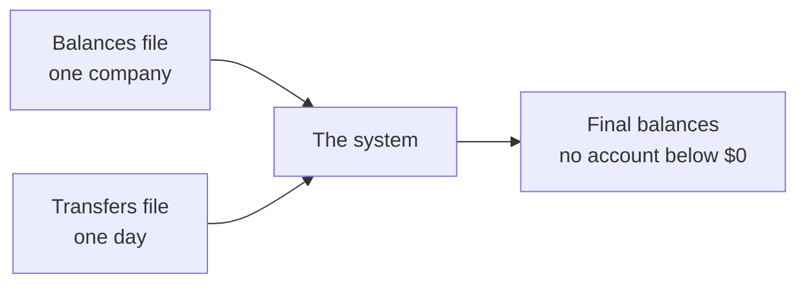

# 1. Request summary

Purpose: say in a few sentences what the challenge asks for, and list the rubric the solution is judged on.

## What the challenge asks for

The [challenge](../challenge/MABLE_BACK_END_CODE_TEST.md) describes a very simple banking service. Each day, a company sends a CSV file of transfers it wants to make between its customers' accounts. A CSV file is a plain text file with one record per line and the values separated by commas.

The system must:

- load the opening balances of the accounts of **one company** from a CSV file;
- then accept **one day's transfers** from a second CSV file and apply them;
- never move money out of an account if that would take its balance below $0.

Each account is identified by a 16-digit number. The challenge gives two sample files: [`mable_account_balances.csv`](../challenge/mable_account_balances.csv) with 5 accounts, and [`mable_transactions.csv`](../challenge/mable_transactions.csv) with 4 transfers.

How these few lines become exact requirements is in [Functional requirements](02-functional-requirements.md). What is left out is in [Scope](04-scope.md).

## The rubric

The challenge judges the solution on the items below. The challenge lists them as checkboxes; they are grouped here under its four headings, in its order.

| Heading | Rubric item |
|---|---|
| Data structure | Uses domain models. |
| Data structure | Uses native data structures readably. |
| Tests | Uses RSpec. |
| Tests | Has some coverage. |
| Tests | Has good coverage. |
| Tests | Tests are orthogonal. |
| Tests | Tests explain the functionality. |
| Object orientation | Models hold their own logic (the challenge says they "encapsulate logic"). |
| Object orientation | Respects separation of concerns. |
| Object orientation | Short methods. |
| Object orientation | Readable methods. |
| General | Runs and provides feedback. |
| General | Calculates the test files accurately. |

What the rubric means for this solution:

- A domain model is a class that stands for a thing in the problem, such as an account or a transfer, and holds that thing's rules. Coverage is the share of the code that the tests run. Separation of concerns means each part of the code has one job, for example reading files or applying transfers.
- "Uses RSpec" means the solution is written in Ruby, because RSpec is a testing tool for Ruby ([DEC-01](../design-analysis/design-decisions.md#dec-01)).
- "Tests are orthogonal" means each rule is tested once, where it lives, so tests do not overlap ([DEC-34](../design-analysis/design-decisions.md#dec-34)).
- "Runs and provides feedback" means the program is run from the command line ([DEC-22](../design-analysis/design-decisions.md#dec-22)) and reports what it did ([DEC-26](../design-analysis/design-decisions.md#dec-26)).
- "The test files" are the two sample CSV files. All four sample transfers must be applied and every closing balance must match exactly ([DEC-35](../design-analysis/design-decisions.md#dec-35)). The closing balances are listed in [Functional requirements](02-functional-requirements.md).

The code-quality items (domain models, separation of concerns, short and readable methods, coverage) become measurable targets in [Non-functional requirements](03-non-functional-requirements.md).

**Reading the rubric's headings (assistant's pick).** In the challenge file, the headings "Object Orientation" and "General" appear at the end of a checkbox line instead of on their own line. This page reads them as headings for the items that follow them, because each one names the group that comes after it. The other reading, that they belong to the item before them, gives items such as "tests explain the functionality Object Orientation", which does not make sense.

[Back to the solution design](README.md)
