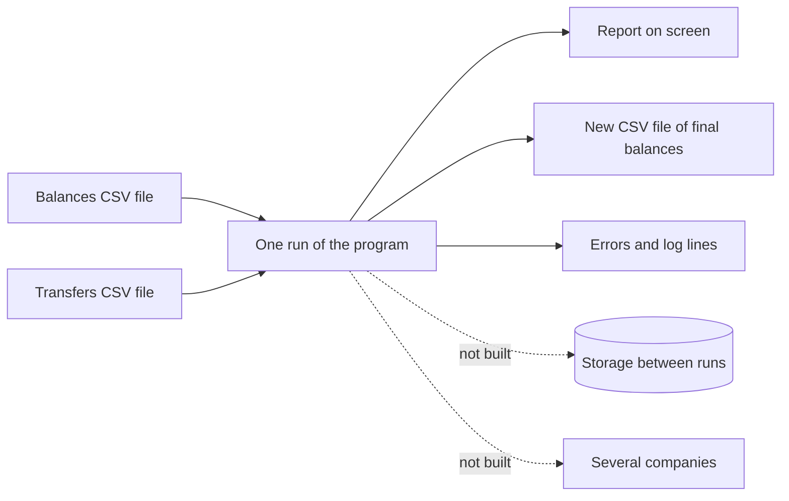

# 4. Scope

What the solution must build, and what it leaves out on purpose, with the reason for each item left out.

Assumptions are not listed here; they are on [page 10](10-traceability-glossary-assumptions.md).

## The boundary at a glance

A run reads two files and produces a report, a new balances file, and errors or log lines. Nothing is kept between runs ([DEC-02](../design-analysis/design-decisions.md#dec-02), [DEC-03](../design-analysis/design-decisions.md#dec-03)).

## In scope

The requirement pages hold the detail. This list only names what is built.

| What is built | Requirement | Decisions |
|---|---|---|
| Load the opening balances of one company from one CSV file (comma-separated values: a text file with one record per line and commas between the values), and stop the run if that file has any problem, reporting every problem with its line number | [FR-01](02-functional-requirements.md) | [DEC-02](../design-analysis/design-decisions.md#dec-02), [DEC-04](../design-analysis/design-decisions.md#dec-04) to [DEC-07](../design-analysis/design-decisions.md#dec-07), [DEC-11](../design-analysis/design-decisions.md#dec-11), [DEC-12](../design-analysis/design-decisions.md#dec-12) |
| Read one day's transfers from a second CSV file, one row at a time | [FR-02](02-functional-requirements.md) | [DEC-20](../design-analysis/design-decisions.md#dec-20), [DEC-21](../design-analysis/design-decisions.md#dec-21), [DEC-32](../design-analysis/design-decisions.md#dec-32) |
| Check that account numbers are exactly 16 digits, that amounts are exact money values with at most 2 decimal places, and that a transfer amount is above $0 | [FR-06](02-functional-requirements.md) | [DEC-08](../design-analysis/design-decisions.md#dec-08), [DEC-09](../design-analysis/design-decisions.md#dec-09), [DEC-10](../design-analysis/design-decisions.md#dec-10) |
| Apply each valid transfer once, in file order, fully or not at all, never taking a balance below $0 (exactly $0.00 is allowed) | [FR-03](02-functional-requirements.md), [FR-04](02-functional-requirements.md), [FR-07](02-functional-requirements.md) | [DEC-13](../design-analysis/design-decisions.md#dec-13), [DEC-15](../design-analysis/design-decisions.md#dec-15), [DEC-16](../design-analysis/design-decisions.md#dec-16), [DEC-18](../design-analysis/design-decisions.md#dec-18) |
| Reject a bad transfer, including one naming an account that is not loaded, with one reason code (a short word naming why it was rejected, for example insufficient_funds), and carry on with the next | [FR-04](02-functional-requirements.md), [FR-05](02-functional-requirements.md) | [DEC-14](../design-analysis/design-decisions.md#dec-14), [DEC-17](../design-analysis/design-decisions.md#dec-17), [DEC-19](../design-analysis/design-decisions.md#dec-19) |
| At the end of the day: check that the total of all balances has not changed, write the final balances to a new CSV file, and print a report on standard output (the normal screen output) | [FR-08](02-functional-requirements.md) | [DEC-24](../design-analysis/design-decisions.md#dec-24), [DEC-26](../design-analysis/design-decisions.md#dec-26), [DEC-27](../design-analysis/design-decisions.md#dec-27), [DEC-35](../design-analysis/design-decisions.md#dec-35) |
| A command-line runner: file paths as arguments, the sample files when there are none, clear errors on standard error (a second screen output, used for errors and log lines), exit status 0 or 1 (the number the program returns when it ends: 0 when the run completed, 1 when it stopped), and logs with masked account numbers | [FR-09](02-functional-requirements.md) | [DEC-22](../design-analysis/design-decisions.md#dec-22), [DEC-23](../design-analysis/design-decisions.md#dec-23), [DEC-25](../design-analysis/design-decisions.md#dec-25), [DEC-28](../design-analysis/design-decisions.md#dec-28), [DEC-29](../design-analysis/design-decisions.md#dec-29) |
| Money exact to the cent, work per transfer that does not grow with the number of accounts, code organised and readable as the rubric describes it, and tests with a coverage report | [NFR-01 to NFR-06](03-non-functional-requirements.md) | [DEC-01](../design-analysis/design-decisions.md#dec-01), [DEC-09](../design-analysis/design-decisions.md#dec-09), [DEC-30](../design-analysis/design-decisions.md#dec-30), [DEC-32](../design-analysis/design-decisions.md#dec-32), [DEC-34](../design-analysis/design-decisions.md#dec-34), [DEC-36](../design-analysis/design-decisions.md#dec-36) |
| Tooling around the code: a style checker (a tool that checks the code follows standard layout and naming rules), an automated job on GitHub that runs the tests and the style checker on every push, and a container file (a file that packages the program with the right Ruby version, so it runs without installing Ruby) as a fallback way to run | [NFR-04](03-non-functional-requirements.md), [NFR-06](03-non-functional-requirements.md) | [DEC-36](../design-analysis/design-decisions.md#dec-36) |
| A README with build, test and run instructions, the assumptions and the design reasoning, and submission as a link to the GitHub repository | [Page 9](09-considerations.md) | [DEC-37](../design-analysis/design-decisions.md#dec-37), [DEC-38](../design-analysis/design-decisions.md#dec-38) |

## Out of scope

These are not built. Each item and reason comes from the [Out of scope](../design-analysis/design-decisions.md#out-of-scope) list in the design decisions. Adding any of them needs the developer's approval first.

| Not built | Reason |
|---|---|
| Several companies, or a configurable company name | The challenge is for a single company, and the files carry no company name ([DEC-02](../design-analysis/design-decisions.md#dec-02)). |
| Persistent storage, and remembering applied files or transfers across runs | Each run starts again from the balances file, so the same two files always give the same result by design ([DEC-03](../design-analysis/design-decisions.md#dec-03)). The README says what a version with storage would need ([DEC-37](../design-analysis/design-decisions.md#dec-37)). |
| Retrying rejected transfers, or any order other than file order | Results would depend on retry rules and be harder to explain and test ([DEC-15](../design-analysis/design-decisions.md#dec-15)). |
| Detecting duplicate transfers | Two equal payments between the same accounts on one day are realistic, so every row is its own transfer ([DEC-16](../design-analysis/design-decisions.md#dec-16)). |
| Creating accounts that are not in the balances file | It would invent accounts the company never provided ([DEC-17](../design-analysis/design-decisions.md#dec-17)). |
| Header detection | A header is not part of the file format. A header row is a bad row, and its message tells the user to remove it ([DEC-06](../design-analysis/design-decisions.md#dec-06)). |
| Check-digit (Luhn) validation of account numbers | The challenge requires only 16 digits, and all five sample account numbers fail the Luhn check ([DEC-08](../design-analysis/design-decisions.md#dec-08)). |
| Rounding or truncating amounts | It would change the amount the company asked for. A value with more than 2 decimal places is rejected instead ([DEC-09](../design-analysis/design-decisions.md#dec-09)). |
| A rollback mechanism, database transactions or sagas (a series of steps, each undone if a later one fails) | Every check runs before any balance changes, so each transfer is all or nothing in memory with nothing to undo ([DEC-18](../design-analysis/design-decisions.md#dec-18)). The README lists them as production options ([DEC-37](../design-analysis/design-decisions.md#dec-37)). |
| Streaming, chunking or memory limits for large files | A day's transfers for one company are small, and the transfers file is already read one row at a time ([DEC-32](../design-analysis/design-decisions.md#dec-32)). The README lists very large files as a production item ([DEC-37](../design-analysis/design-decisions.md#dec-37)). |
| Masking account numbers on screen or in the output CSV | The user needs full numbers to check the result against the input files. Numbers are masked in the logs only ([DEC-29](../design-analysis/design-decisions.md#dec-29)). |
| Logging to a file or a logging service | Over-engineering for this challenge. The logger is passed in, so it can be pointed elsewhere later without changing the program's core ([DEC-28](../design-analysis/design-decisions.md#dec-28)). |
| Named command-line options, a `--force` option or a help option | Positional arguments (file paths given in a fixed order, with no option names) are enough, and every run writes its own new output file, so nothing needs forcing ([DEC-22](../design-analysis/design-decisions.md#dec-22), [DEC-27](../design-analysis/design-decisions.md#dec-27)). |
| A money gem (a third-party money library) | The solution's own money model on Ruby's standard library is exact and enough ([DEC-01](../design-analysis/design-decisions.md#dec-01), [DEC-09](../design-analysis/design-decisions.md#dec-09)). |
| A coverage threshold that fails the build | Nobody asked for one; the coverage figure is reported in the README instead ([DEC-36](../design-analysis/design-decisions.md#dec-36)). |

Other options the decisions considered and rejected, with their pros and cons, are on the [alternatives](08-alternatives/README.md) pages.

[Back to the solution design](README.md)
