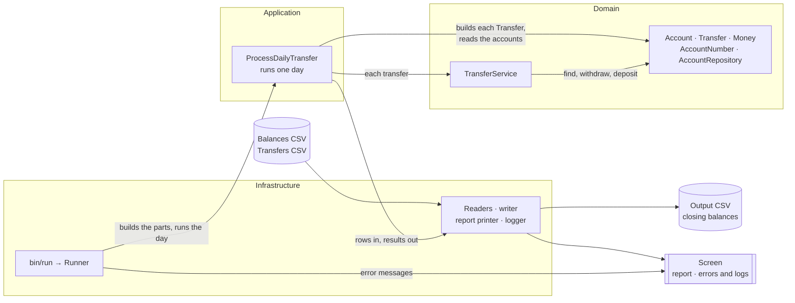
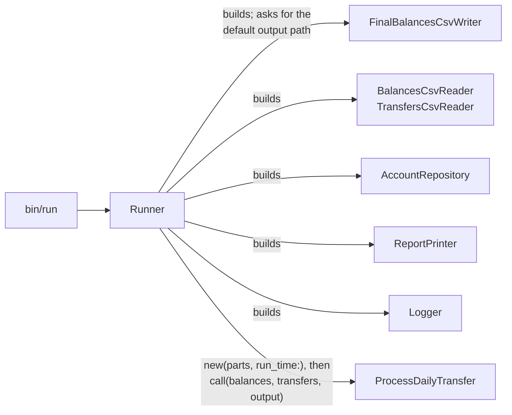
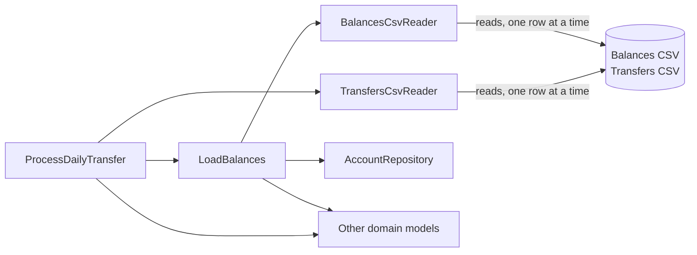
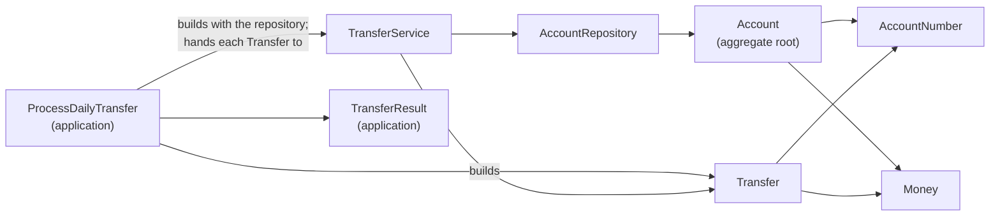
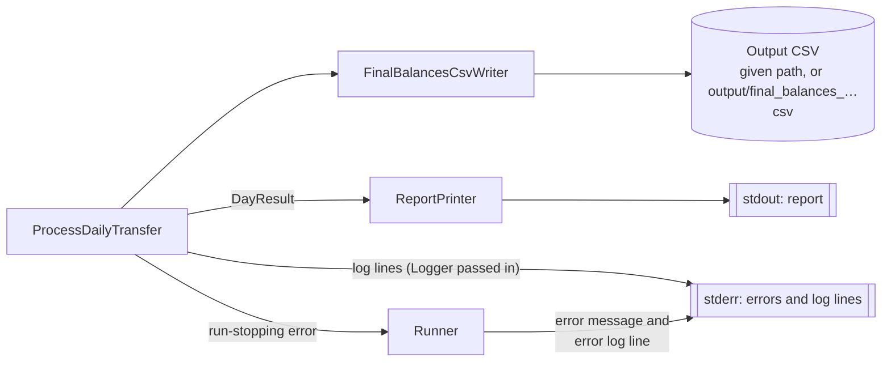

# 5. High-level design

Purpose: show how the program is put together, where data comes in and goes out, and where a new input format or a new transfer rule would be added.

This is the updated high-level design that replaces the developer's handwritten sketch. It adds the parts the sketch did not have: validation, rejection reasons, the summary and logging ([DEC-33](../design-analysis/design-decisions.md#dec-33)). Each component is described in full on [page 6](06-components.md); the step-by-step flows are on [page 7](07-logical-flow/README.md).

## Overview

The whole program in one diagram; the four diagrams below show each part in detail.

## The three layers

The code is split into three folders under `lib/` ([DEC-30](../design-analysis/design-decisions.md#dec-30)): `lib/infrastructure/`, `lib/application/` and `lib/domain/`.

- **Infrastructure** (`lib/infrastructure/`): everything that touches the outside world. It reads the CSV files, writes the output file, prints the report and runs the command.
- **Application** (`lib/application/`): runs one day. It loads the balances, applies each transfer in file order, keeps each row's outcome as a `TransferResult`, writes the output and prints the report through the parts it is given.
- **Domain** (`lib/domain/`): the business rules. A *domain model* is a class named after a business idea, such as `Account` or `Money`, that holds its own rules. The domain knows nothing about files, line numbers, the screen or the logger.

Each layer uses only the layers inside it: infrastructure uses the application and the domain, and the application uses only the domain. The application reaches the files, the screen and the logger only through the parts it is given, and `UnreadableFile`, the error a reader raises, is defined with the application's own errors.

## Diagram 1: what the Runner builds and passes in

*Passed in* and *repository* are defined in the [glossary](10-traceability-glossary-assumptions.md#glossary).

- `bin/run` passes only the command-line arguments. The `Runner` reads the clock once, works out and checks the output path, puts every part it built into one `ProcessDailyTransfer::Parts` value, creates `ProcessDailyTransfer.new(parts, run_time:)`, and then calls it with the balances, transfers and output paths, so the checked path and the written path are always the same ([DEC-25](../design-analysis/design-decisions.md#dec-25), [DEC-27](../design-analysis/design-decisions.md#dec-27), [DEC-28](../design-analysis/design-decisions.md#dec-28), [DEC-30](../design-analysis/design-decisions.md#dec-30), [DEC-31](../design-analysis/design-decisions.md#dec-31)). The steps in order are under [`Runner` on page 6](06-components.md#runner).
- Because every part and the run time are passed in, tests pass fakes and a fixed time instead; which ones is under [`ProcessDailyTransfer` on page 6](06-components.md#processdailytransfer) ([DEC-24](../design-analysis/design-decisions.md#dec-24), [DEC-34](../design-analysis/design-decisions.md#dec-34)).

## Diagram 2: how the input files are read

- The CSV files are read only in infrastructure, by the two readers through their shared helper `CsvRows`. It uses Ruby's CSV library, skips blank lines, trims spaces and tabs, and gives each row as a `Row`: text fields with its physical line number ([DEC-04](../design-analysis/design-decisions.md#dec-04), [DEC-05](../design-analysis/design-decisions.md#dec-05), [DEC-07](../design-analysis/design-decisions.md#dec-07)).
- The readers give only the shape of a row: each `Row` carries the number of fields expected, so `Row#wrong_field_count?` finds a row with the wrong number, and a header hint when the first row looks like a header ([DEC-06](../design-analysis/design-decisions.md#dec-06)). `CsvRows` raises `UnreadableFile` for a file it cannot open or a line it cannot read. Every value rule is checked in the domain.
- The transfers file is read one row at a time (`CSV.open`, one row per `shift`), and each transfer is applied as its row is read. The balances file is read in full, collecting every problem, before any transfer is read. Both go through the same row reader, `CsvRows` ([DEC-32](../design-analysis/design-decisions.md#dec-32)).
- `LoadBalances` fills the repository that was passed in, and the repository stays the one place that knows about duplicates; how each row is checked is on [page 6](06-components.md#loadbalances) ([DEC-12](../design-analysis/design-decisions.md#dec-12), [DEC-31](../design-analysis/design-decisions.md#dec-31)).

## Diagram 3: the domain models

*Aggregate root*, `BigDecimal` and *reason code* are defined in the [glossary](10-traceability-glossary-assumptions.md#glossary); here `Account` is the aggregate root that guards its balance.

Each rule lives in the model that owns the data it checks, and each model raises its own error when the rule is broken ([DEC-30](../design-analysis/design-decisions.md#dec-30)). Which error each model raises is in the [errors table on page 6](06-components.md#errors-and-who-raises-them).

| Model | Rule it guards |
|---|---|
| `AccountNumber` | exactly 16 digits, kept as text ([DEC-08](../design-analysis/design-decisions.md#dec-08)) |
| `Money` | exact amount on `BigDecimal`, at most 2 decimal places, always written with 2 ([DEC-09](../design-analysis/design-decisions.md#dec-09)) |
| `Transfer` | the two accounts differ, and the amount is above $0 ([DEC-10](../design-analysis/design-decisions.md#dec-10), [DEC-13](../design-analysis/design-decisions.md#dec-13)) |
| `Account` | the opening balance is not negative; a withdrawal must not take the balance below $0; exactly $0.00 is allowed; a deposit or withdrawal of $0 or less is a programming error ([DEC-10](../design-analysis/design-decisions.md#dec-10), [DEC-11](../design-analysis/design-decisions.md#dec-11), [DEC-13](../design-analysis/design-decisions.md#dec-13), [DEC-18](../design-analysis/design-decisions.md#dec-18)) |
| `AccountRepository` | no duplicate account on add; unknown account on find; accounts kept in load order ([DEC-31](../design-analysis/design-decisions.md#dec-31)) |

`TransferService` applies each transfer all or nothing; why the order of its steps makes that so is on [page 7.1](07-logical-flow/01-apply-one-transfer.md) ([DEC-18](../design-analysis/design-decisions.md#dec-18)). `ProcessDailyTransfer` records each transfer's outcome as a `TransferResult`, the application's record of the row: applied, or rejected with one reason code ([DEC-19](../design-analysis/design-decisions.md#dec-19)). `ProcessDailyTransfer` turns each domain error a transfer can raise (`InvalidAccountNumber`, `InvalidAmount`, `SameAccount`, `UnknownAccount`, `InsufficientFunds`) into its reason code, and a row with the wrong number of fields into `malformed_row` ([DEC-19](../design-analysis/design-decisions.md#dec-19)); the mapping is in the [errors table on page 6](06-components.md#errors-and-who-raises-them). Why `Account` is the aggregate root is explained on [page 6](06-components.md#why-account-is-the-aggregate-root).

## Diagram 4: where the results and errors go

*stdout* and *stderr* (standard output and standard error) are defined in the [glossary](10-traceability-glossary-assumptions.md#glossary). `DayResult` holds everything the report needs about a completed run.

- **A rejected transfer is not an error that stops the run.** The reader marks a row with the wrong number of fields, or a domain model raises an error that has a reason code. `ProcessDailyTransfer` turns that into a rejected `TransferResult` with its reason code, logs it at warn level ([DEC-28](../design-analysis/design-decisions.md#dec-28)), and goes on to the next row ([DEC-14](../design-analysis/design-decisions.md#dec-14), [DEC-17](../design-analysis/design-decisions.md#dec-17), [DEC-19](../design-analysis/design-decisions.md#dec-19)).
- **Errors that stop the run go up to the `Runner`.** The five run-stopping errors, and who raises each, are in the [errors table on page 6](06-components.md#errors-and-who-raises-them). For each error that reaches it, the `Runner` prints the plain message on stderr, logs one line at error level, and exits with status 1 ([DEC-25](../design-analysis/design-decisions.md#dec-25), [DEC-28](../design-analysis/design-decisions.md#dec-28)).
- **Start checks are done by the `Runner` before the day starts:** the number of arguments, then the input and output files together ([DEC-22](../design-analysis/design-decisions.md#dec-22), [DEC-23](../design-analysis/design-decisions.md#dec-23), [DEC-25](../design-analysis/design-decisions.md#dec-25)). What each stop prints, and its exit status, is in the [exit code table on page 9](09-considerations.md#standard-output-standard-error-and-exit-codes).
- **Log lines** go to standard error through the `Logger`, with account numbers masked ([DEC-28](../design-analysis/design-decisions.md#dec-28), [DEC-29](../design-analysis/design-decisions.md#dec-29)). `ProcessDailyTransfer` logs the info and warn lines, with the text of each from [`LogMessages`](06-components.md#logmessages), or from `DayResult::ALL_REJECTED_WARNING` for the all-rejected warning. The `Runner` logs the one error line: the text from the error's `stop_reason`, or `start checks failed (…)` when the start checks fail. A usage error logs nothing. What is logged at each level is in the [stream table on page 9](09-considerations.md#standard-output-standard-error-and-exit-codes).
- **The output CSV** is written by `FinalBalancesCsvWriter`, never over an existing file ([DEC-27](../design-analysis/design-decisions.md#dec-27)).
- **The report** is printed on stdout by `ProcessDailyTransfer` through the `ReportPrinter` it was given, only for a completed run; the order of the output file, the report and the exit status is on [page 7.9](07-logical-flow/09-run-output-and-exit-code.md) ([DEC-25](../design-analysis/design-decisions.md#dec-25), [DEC-26](../design-analysis/design-decisions.md#dec-26)).

The exact report layout and messages are on [page 2](02-functional-requirements.md); error handling by layer is on [page 9](09-considerations.md).

## Adding another input format

A new format, for example JSON, needs a new reader in infrastructure. It must offer the same method as the CSV readers, `each_row(path)`, yielding one `Row` per record (its line number, its text fields, the number of fields expected and any header hint), and raise `UnreadableFile` for a file it cannot open, or, with the line number, for a line it cannot read. A new transfers reader must also yield one row at a time ([DEC-32](../design-analysis/design-decisions.md#dec-32)). Because the readers are passed in, the only other change is in the `Runner`, which builds the new reader instead of the CSV one. `ProcessDailyTransfer`, `LoadBalances` and the domain do not change. How the `Runner` would choose between formats, for example by file extension, is not covered by the decisions.

## Adding another transfer rule

A new rule, for example a maximum amount for a single transfer, goes into the domain model that owns the data it checks (here `Transfer`):

- a rule about one transfer's own values goes in `Transfer`;
- a rule about a balance goes in `Account`;
- a rule about which accounts exist goes in `AccountRepository`.

`TransferService` keeps its order: every check before any balance changes ([DEC-18](../design-analysis/design-decisions.md#dec-18)). A new rule also needs a new error, a new reason code and a place in the check order ([DEC-19](../design-analysis/design-decisions.md#dec-19)), and these are decisions. So a new rule must first be agreed as a new decision in [`design-decisions.md`](../design-analysis/design-decisions.md). The readers, the writer and the `Runner` do not change. `ProcessDailyTransfer` maps the new error to its reason code in `REJECTIONS`, the code is added to `TransferResult::REASON_CODES` in its place in the check order, and the report and the log show it like any other.

More on extensibility is on [page 9](09-considerations.md).

[Back to the solution design](README.md)
