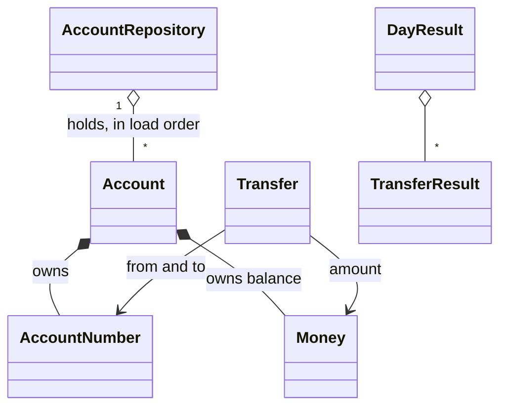

# 6. Components

What each component is responsible for, what it takes in and gives back, and what it must not do.

The code has three folders ([DEC-30](../design-analysis/design-decisions.md#dec-30)): `domain/` holds the business rules, `application/` runs the day using those rules, and `infrastructure/` deals with files, the screen and the command line. The [high-level design](05-high-level-design.md) shows how they fit together, including what the `Runner` builds and passes in; the [logical flow](07-logical-flow/README.md) shows them working in order.

Six terms used below:

- An **aggregate root** is the one model that owns a piece of changing data and guards its rules. Other code may change that data only by asking the root.
- A **value** model (such as `Money`) holds data that never changes once it is built. Two values with the same content are equal.
- A **repository** is the one place that holds the accounts and finds them by number.
- **Passed in** means a class is given the parts it uses when it is created, instead of creating them itself. A test can then pass a fake part in their place.
- A **reason code** is a short fixed word that says why a transfer was rejected, such as `insufficient_funds` ([DEC-19](../design-analysis/design-decisions.md#dec-19)).
- **Masked** means an account number shown in the logs with only its last 4 digits, as `************6789` ([DEC-29](../design-analysis/design-decisions.md#dec-29)).

---

## Who owns which data

A filled diamond (`*--`) means the part belongs to that model alone; an open diamond (`o--`) means the model holds a collection of them.

| Data | Owner | Notes |
|---|---|---|
| An account's number and balance | `Account` | The balance changes only through `withdraw` and `deposit`. |
| The set of accounts, and their load order | `AccountRepository` | One account per number ([DEC-31](../design-analysis/design-decisions.md#dec-31)). It is the only place that knows whether a number is already held. |
| One requested movement of money | `Transfer` | Refers to accounts by number, never holds an `Account`. |
| The outcome of one transfers row | `TransferResult` | Applied, or rejected with one reason code ([DEC-19](../design-analysis/design-decisions.md#dec-19)). |
| Where each account first appeared | `LoadBalances` | The repository does not know line numbers ([DEC-31](../design-analysis/design-decisions.md#dec-31)); `LoadBalances` adds the first line to the duplicate message ([DEC-12](../design-analysis/design-decisions.md#dec-12)). |
| The run time and the output path | `Runner` | Read and worked out once, then passed to `ProcessDailyTransfer` ([DEC-27](../design-analysis/design-decisions.md#dec-27), [DEC-30](../design-analysis/design-decisions.md#dec-30)). |
| The whole day's outcome | `DayResult` | Built once, at the end of a completed run. |

## Why `Account` is the aggregate root

- **It owns the only data that changes.** Every other domain model is a value, a result, or a helper that only finds accounts (`AccountRepository`) or moves money between them (`TransferService`). A balance is the one thing a run changes.
- **It guards the main rule.** "No balance below $0" is a rule about one account's balance, so it lives in `Account#withdraw` ([DEC-13](../design-analysis/design-decisions.md#dec-13), [DEC-30](../design-analysis/design-decisions.md#dec-30)).
- **Nothing else can change a balance.** The repository hands out `Account`s, and the only way to change one is `withdraw` or `deposit`. So the rule cannot be bypassed.
- **`Transfer` is not the root.** It owns no balance. It is a request that touches two accounts, and `TransferService` carries it out by asking each account in turn ([DEC-18](../design-analysis/design-decisions.md#dec-18)).

The rejected options for the aggregate root are on the [accounts and aggregate root alternatives](08-alternatives/02-accounts-and-aggregate-root.md) page.

## Which checks live where

Each rule is checked in one place only ([DEC-30](../design-analysis/design-decisions.md#dec-30), [DEC-31](../design-analysis/design-decisions.md#dec-31)), so it is tested once there ([DEC-34](../design-analysis/design-decisions.md#dec-34)).

| Layer | Checks | Why here |
|---|---|---|
| File reading (`BalancesCsvReader`, `TransfersCsvReader`) | Blank lines skipped ([DEC-05](../design-analysis/design-decisions.md#dec-05)); number of fields in a row ([DEC-04](../design-analysis/design-decisions.md#dec-04)); the header hint ([DEC-06](../design-analysis/design-decisions.md#dec-06)); a file that cannot be opened, or that the CSV library cannot read past a line ([DEC-04](../design-analysis/design-decisions.md#dec-04), [DEC-23](../design-analysis/design-decisions.md#dec-23)) | These are about the shape of the file, not about money or accounts. A new file format would bring its own reader. |
| Domain | 16 digits ([DEC-08](../design-analysis/design-decisions.md#dec-08)); money format ([DEC-09](../design-analysis/design-decisions.md#dec-09)); negative balance ([DEC-11](../design-analysis/design-decisions.md#dec-11)); amount above $0 ([DEC-10](../design-analysis/design-decisions.md#dec-10)); same account ([DEC-13](../design-analysis/design-decisions.md#dec-13)); unknown account ([DEC-17](../design-analysis/design-decisions.md#dec-17), [DEC-31](../design-analysis/design-decisions.md#dec-31)); duplicate account ([DEC-31](../design-analysis/design-decisions.md#dec-31)); no overdraft ([DEC-13](../design-analysis/design-decisions.md#dec-13)) | These are business rules. They hold whatever the input format is. |
| Application | Collecting every balances problem ([DEC-12](../design-analysis/design-decisions.md#dec-12)); an empty balances or transfers file ([DEC-11](../design-analysis/design-decisions.md#dec-11), [DEC-20](../design-analysis/design-decisions.md#dec-20)); the all-rejected warning ([DEC-21](../design-analysis/design-decisions.md#dec-21)); the total check ([DEC-24](../design-analysis/design-decisions.md#dec-24)) | These are about the run as a whole, not one value or one row. |
| Runner | Number of arguments ([DEC-22](../design-analysis/design-decisions.md#dec-22)); input files exist and the output file does not, checked together ([DEC-23](../design-analysis/design-decisions.md#dec-23), [DEC-25](../design-analysis/design-decisions.md#dec-25)); `LOG_LEVEL` ([DEC-28](../design-analysis/design-decisions.md#dec-28)) | These are about how the program was started. |

Each error's reason code is in the [errors table](#errors-and-who-raises-them) below. The order the checks run in is on the [logical flow](07-logical-flow/01-apply-one-transfer.md) pages. The exact messages are on the [functional requirements](02-functional-requirements.md) page.

## Errors and who raises them

Each check raises a named error. **Domain errors** are about one value, one row or one account. The application layer catches every one of them and turns it into a balances problem or a rejected transfer, so none reaches the `Runner`. **Run-stopping errors** end the run and only the `Runner` catches them, with one exception: `LoadBalances` catches an `UnreadableFile` at a line in the balances file and adds it as the last problem in `InvalidBalancesFile`.

| Error | Kind | Raised by | Folder | Becomes |
|---|---|---|---|---|
| `InvalidAccountNumber` | Domain | `AccountNumber` | `domain/` | A balances problem, or `invalid_account_number` |
| `InvalidAmount` | Domain | `Money` (bad format, more than 2 decimals); `Transfer` (amount of $0 or less) | `domain/` | A balances problem, or `invalid_amount` |
| `SameAccount` | Domain | `Transfer` | `domain/` | `same_account` |
| `NegativeBalance` | Domain | `Account` (negative opening balance) | `domain/` | A balances problem |
| `UnknownAccount` | Domain | `AccountRepository#find` | `domain/` | `unknown_account` |
| `DuplicateAccount` | Domain | `AccountRepository#add` | `domain/` | A guard only; `LoadBalances` finds a duplicate first with `include?` |
| `InsufficientFunds` | Domain | `Account#withdraw` | `domain/` | `insufficient_funds` |
| `InvalidBalancesFile` | Run-stopping | `LoadBalances` | `application/` | Every problem with its line number, exit 1 |
| `NoTransfers` | Run-stopping | `ProcessDailyTransfer` | `application/` | Exit 1 |
| `TotalChanged` | Run-stopping | `ProcessDailyTransfer` | `application/` | Exit 1 |
| `UnreadableFile` | Run-stopping | `BalancesCsvReader`, `TransfersCsvReader` | `infrastructure/` | Exit 1; in the balances file at a line, the last problem in `InvalidBalancesFile` |
| `OutputNotWritable` | Run-stopping | `FinalBalancesCsvWriter` | `infrastructure/` | Exit 1 |

The reason codes come from [DEC-19](../design-analysis/design-decisions.md#dec-19). The `malformed_row` reason comes from the reader's field-count mark, not from an error.

---

## Domain components (`domain/`)

### `AccountNumber`

- **Responsibility:** one account number: exactly 16 digits, kept as text so leading zeros stay ([DEC-08](../design-analysis/design-decisions.md#dec-08)).
- **In:** the text from a file field, already trimmed.
- **Out:** a value that compares equal to another `AccountNumber` with the same digits, and its full text for the report and the output file. Raises `InvalidAccountNumber` for any other text.
- **Does not:** turn the number into an integer; run a check-digit check; mask itself (masking also applies to values that are not valid account numbers, see [`LogMessages`](#logmessages)).

### `Money`

- **Responsibility:** one exact amount on `BigDecimal` (Ruby's exact decimal number type), with at most 2 decimal places ([DEC-09](../design-analysis/design-decisions.md#dec-09)).
- **In:** text in the format of [DEC-09](../design-analysis/design-decisions.md#dec-09), including a leading minus sign.
- **Out:** a value that can be added, subtracted and compared, and its text with exactly 2 decimal places. Raises `InvalidAmount` for empty text, text that is not a number, or more than 2 decimal places. It records that a minus sign was written, so `-0.00` counts as negative. **(assistant's pick)**
- **Does not:** round or truncate; use floating point; accept `+100`, `1e3`, `$100` or any other format outside [DEC-09](../design-analysis/design-decisions.md#dec-09); decide whether a negative amount is allowed.

### `Account`

- **Responsibility:** the aggregate root. Owns its `AccountNumber` and its balance, and keeps the balance at $0.00 or more ([DEC-13](../design-analysis/design-decisions.md#dec-13)).
- **In:** an `AccountNumber` and an opening balance as `Money`; then `withdraw(money)` and `deposit(money)`.
- **Out:** its number and current balance. `withdraw` raises `InsufficientFunds` when the balance would go below $0, and changes nothing in that case. A withdrawal that leaves exactly $0.00 succeeds. `deposit` cannot fail for a valid transfer. Both raise `ArgumentError` for an amount of $0 or less: a programming error, because `Transfer` has already refused such an amount ([DEC-18](../design-analysis/design-decisions.md#dec-18)). One private check serves both. **(assistant's pick)** It raises `NegativeBalance` for a negative opening balance ([DEC-11](../design-analysis/design-decisions.md#dec-11)). The opening-balance rule is also offered as a class-level check on `Account` that needs only the `Money`, so `LoadBalances` can run it even when the account number is invalid. **(assistant's pick)**
- **Does not:** know about other accounts, transfers, files or line numbers.

### `Transfer`

- **Responsibility:** one requested movement of money: from account, to account, amount ([DEC-30](../design-analysis/design-decisions.md#dec-30)).
- **In:** two `AccountNumber`s and a `Money` amount.
- **Out:** a value holding the three. It raises `InvalidAmount` for an amount of $0 or less, then `SameAccount` for the same account on both sides. It checks the amount first, so a row with both problems gets `invalid_amount`, as the order in [DEC-19](../design-analysis/design-decisions.md#dec-19) requires.
- **Does not:** look up accounts, check balances or change anything. It does not hold `Account` objects.

### `TransferResult`

- **Responsibility:** the outcome of one transfers row: applied, or rejected with exactly one reason code ([DEC-19](../design-analysis/design-decisions.md#dec-19)). A domain result, not a DTO (a "data transfer object", a plain data carrier between layers).
- **In:** the line number, the row's values as written (after trimming), and applied or a reason code. A rejected header-looking row also carries the header message ([DEC-06](../design-analysis/design-decisions.md#dec-06)). **(assistant's pick)**
- **Out:** whether it was applied, its reason code, and its values for the report and the log.
- **Does not:** format itself for the screen or the log; that is `ReportPrinter`'s and `ProcessDailyTransfer`'s job.

### `AccountRepository`

- **Responsibility:** holds the run's accounts in memory and is the one place for the duplicate and unknown-account rules ([DEC-31](../design-analysis/design-decisions.md#dec-31)).
- **In:** `add(account)`; `include?(account_number)`; `find(account_number)`; `all`.
- **Out:** `add` raises `DuplicateAccount` for a number already held. `include?` says whether a number is already held; `LoadBalances` uses it to report a duplicate before checking the balance. The method name `include?` is the **(assistant's pick)**. `find` returns the `Account` or raises `UnknownAccount`. `all` returns the accounts in load order. Adding, checking and finding take the same time however many accounts there are.
- **Does not:** know line numbers; create an account on `find`; store anything between runs ([DEC-03](../design-analysis/design-decisions.md#dec-03), [DEC-17](../design-analysis/design-decisions.md#dec-17)).

### `TransferService`

- **Responsibility:** applies one `Transfer`, all or nothing ([DEC-18](../design-analysis/design-decisions.md#dec-18)).
- **In:** a `Transfer` and the repository.
- **Out:** both balances changed, or an `UnknownAccount` or `InsufficientFunds` error with both balances unchanged. It finds both accounts first, then calls `withdraw`, and only then `deposit`.
- **Does not:** read rows, build `TransferResult`s, log, or undo anything. Nothing needs undoing, because every check runs before the first change.

### Domain errors

- `InvalidAccountNumber`, `InvalidAmount`, `SameAccount`, `NegativeBalance`, `UnknownAccount`, `DuplicateAccount` and `InsufficientFunds`; who raises each is in the [errors table](#errors-and-who-raises-them).
- They name the value or account number involved. They carry no line number and no reason code; the application layer adds those.

---

## Application components (`application/`)

### `LoadBalances`

- **Responsibility:** turns the balances rows into `Account`s in the repository, or reports every problem in the file ([DEC-11](../design-analysis/design-decisions.md#dec-11), [DEC-12](../design-analysis/design-decisions.md#dec-12)).
- **In:** the `BalancesCsvReader` and the balances path, and the repository, all given by `ProcessDailyTransfer`. It asks the reader for the rows, each with its line number.
- **Out:** a filled repository, or `InvalidBalancesFile` listing every problem with its line number. For each row, in this order, it:
  1. if the reader marked the row with the wrong number of fields, reports only that problem (followed by the header hint when the reader marked one) and goes to the next row, because it is not known which value is which;
  2. builds the `AccountNumber` (a problem on `InvalidAccountNumber`), with the header hint added when the reader marked the row as header-looking ([DEC-06](../design-analysis/design-decisions.md#dec-06));
  3. if the number is valid, asks the repository `include?`; if it is already held, reports the duplicate, naming the line where the account first appeared ([DEC-12](../design-analysis/design-decisions.md#dec-12));
  4. builds the `Money` and runs the `Account` opening-balance check (a problem on `InvalidAmount` or `NegativeBalance`);
  5. adds the `Account` only if the row has no problem, and records that row's line as the line where the account first appeared, so a later duplicate names the copy the repository holds. **(assistant's pick)**

  For a row with the right number of fields, steps 2 to 4 run separately, so a row with several problems reports each one ([DEC-12](../design-analysis/design-decisions.md#dec-12)). If the file has no rows, it raises `InvalidBalancesFile` with the single no-rows problem, which has its own message ([DEC-11](../design-analysis/design-decisions.md#dec-11)). **(assistant's pick)** If the reader raises `UnreadableFile` at a line, `LoadBalances` keeps the problems in the rows before it and adds the read error as the last problem ([DEC-04](../design-analysis/design-decisions.md#dec-04)). An `UnreadableFile` for a file that cannot be opened at all passes straight through to the `Runner`, because it has its own message and no rows were read. **(assistant's pick)**
- **Known gap:** if the first copy of an account is the invalid row, that account was never added, so the next copy is added instead and is not reported as a duplicate. The duplicate is reported only after the first row is fixed. The run still stops either way, because the first row is a problem.
- **Does not:** check digits or money format itself (the domain does); keep its own list of accounts; stop at the first problem; apply any transfer.

### `ProcessDailyTransfer`

- **Responsibility:** runs the day. Takes the run time in its constructor, defaulting to the current time ([DEC-30](../design-analysis/design-decisions.md#dec-30)). The balances reader, the transfers reader, the writer, the repository, the reporter (`ReportPrinter`) and the logger are all passed in to its constructor ([DEC-28](../design-analysis/design-decisions.md#dec-28)), as one parameter object that names each part ([P30](../prompts/prompts-refactor-phase.md#p30)): `ProcessDailyTransfer::Parts`, a `Data.define` nested in the class, with the run time as a separate keyword. **(assistant's pick: the nesting, `Data.define` and the separate run time)** The `Runner` builds the real ones. It creates `LoadBalances` and `TransferService` itself, giving them the parts it was given; they touch no file, screen or clock, so tests reach them through those parts. **(assistant's pick)** Tests pass fakes, for example a repository whose total changes ([DEC-24](../design-analysis/design-decisions.md#dec-24)) and a reporter that records whether a report was printed.
- **In:** the balances path, the transfers path and the output path. The `Runner` always gives the output path. If a caller leaves it out, `ProcessDailyTransfer` asks `FinalBalancesCsvWriter.default_path` for its run time. **(assistant's pick)** The readers are given the paths when they are asked to read, not when they are built. **(assistant's pick)**
- **Out:** a `DayResult`, or a run-stopping error. In order, it:
  1. logs the run start, loads the balances through `LoadBalances`, notes each account's opening balance before any transfer is applied, and adds up the total before from those opening balances;
  2. reads each transfers row in file order ([DEC-15](../design-analysis/design-decisions.md#dec-15)), builds the `AccountNumber`s, the `Money` and the `Transfer`, and hands it to `TransferService`;
  3. turns each outcome, or the domain error that refused it, into a `TransferResult` with its reason code, as in the [errors table](#errors-and-who-raises-them); a row the reader marked with the wrong number of fields becomes `malformed_row` ([DEC-19](../design-analysis/design-decisions.md#dec-19));
  4. logs each result, at info if applied and at warn if rejected, with account numbers masked ([DEC-28](../design-analysis/design-decisions.md#dec-28), [DEC-29](../design-analysis/design-decisions.md#dec-29)). It decides when to log and at which level; the text of every log line, masking included, comes from [`LogMessages`](#logmessages), except the all-rejected warning, whose text `DayResult` owns (shared with the report). **(assistant's pick)**
  5. raises `NoTransfers` if there were no transfers rows ([DEC-20](../design-analysis/design-decisions.md#dec-20)); logs the warning if every row was rejected ([DEC-21](../design-analysis/design-decisions.md#dec-21));
  6. adds up the total after from `all`, and raises `TotalChanged` if it differs from the total before ([DEC-24](../design-analysis/design-decisions.md#dec-24)). **(assistant's pick)**
  7. writes the output file through the writer ([DEC-27](../design-analysis/design-decisions.md#dec-27));
  8. prints the report through the reporter, only after the file is written ([DEC-26](../design-analysis/design-decisions.md#dec-26));
  9. logs the run end with the counts per reason ([DEC-28](../design-analysis/design-decisions.md#dec-28)).
- **Does not:** create its own readers, writer, repository, reporter or logger; read the clock when a run time is given; write to standard output except through the reporter; parse CSV; check arguments or file existence; print error messages; set the exit status; retry a rejected transfer; build the text of a log line or mask a value.

### `LogMessages`

- **Responsibility:** the text of each log line of the day's run, except the all-rejected warning, whose text `DayResult` owns (shared with the report), with account values masked ([DEC-28](../design-analysis/design-decisions.md#dec-28), [DEC-29](../design-analysis/design-decisions.md#dec-29)). It keeps `ProcessDailyTransfer` to running the day. **(assistant's pick)**
- **In:** for `run_started`, the balances and transfers paths as given; for `applied` and `rejected`, a `TransferResult`; for `run_ended`, the `DayResult`; for `mask`, any text.
- **Out:** the text of one log line:
  - `run_started`: `Run started: balances <path>, transfers <path>`;
  - `applied`: `Line <N> applied: <from> -> <to> <amount>`, with both accounts masked and the amount as `Money` writes it;
  - `rejected`: `Line <N> rejected: ` then the masked from, `-> ` and the masked to, and the amount as written (`""` when empty), then the reason code; fields the row does not have are left out, and fields after the third are not shown;
  - `run_ended`: `Run ended: processed 
, applied <a>, rejected <r>`, then the count per reason in [DEC-19](../design-analysis/design-decisions.md#dec-19) order in brackets when any row was rejected;
  - `mask`: every character except the last 4 becomes `*`; a value of 4 characters or fewer, including an empty value, is `****`.
- **Does not:** write to the logger or any stream; decide when a line is logged or at which level; show the header hint.

### `DayResult`

- **Responsibility:** everything the report needs about a completed run.
- **In:** the `TransferResult`s, the totals before and after, the opening balance of each account by account number, the final accounts in load order, and the output path.
- **Out:** the same data, read by `ReportPrinter`.
- **Does not:** format or print anything; change any account.

### Application errors

- `InvalidBalancesFile`, `NoTransfers` and `TotalChanged`; who raises each is in the [errors table](#errors-and-who-raises-them).
- `InvalidBalancesFile` carries every problem with its line number, so the `Runner` can print them all.

---

## Infrastructure components (`infrastructure/`)

### `BalancesCsvReader` and `TransfersCsvReader`

- **Responsibility:** read a file with Ruby's CSV library, opened as `bom|utf-8` so a byte-order mark (an invisible marker some editors put at the start of a file) is ignored, and give each row with its physical line number ([DEC-04](../design-analysis/design-decisions.md#dec-04), [DEC-07](../design-analysis/design-decisions.md#dec-07)). Both read through the shared helper [`CsvRows`](#infrastructure-helpers-csvrows-row-and-displaypath), which gives each row as a `Row`.
- **In:** a file path.
- **Out:** each row's values, trimmed, with its line number. A row with the wrong number of fields is marked as such, and a header-looking first row is marked with the header hint ([DEC-06](../design-analysis/design-decisions.md#dec-06)). A file that cannot be opened raises `UnreadableFile` with the reason from the system. A file the CSV library cannot read past a line raises `UnreadableFile` naming that line, after giving every row before it. `BalancesCsvReader` reads the whole file; `TransfersCsvReader` gives one row at a time ([DEC-32](../design-analysis/design-decisions.md#dec-32)).
- **Does not:** check account numbers or amounts; build domain models; skip a header ([DEC-06](../design-analysis/design-decisions.md#dec-06)); check whether the file exists (the `Runner` does).

### `FinalBalancesCsvWriter`

- **Responsibility:** names and writes the final balances file ([DEC-27](../design-analysis/design-decisions.md#dec-27)).
- **In:** the run time, for the class method `FinalBalancesCsvWriter.default_path(run_time)`, the method name being the **(assistant's pick)**; then, for an instance, the accounts in load order and the output path.
- **Out:** `default_path` gives `output/final_balances_YYYY-MM-DD_HHMMSS.csv` for the run time. Writing gives the file, in the balances input format, with LF (line feed only) line endings, on every operating system **(assistant's pick)**, reason on [page 9](09-considerations.md#portability-and-ci). It creates missing folders and creates the file only if it does not exist at that moment. If the file appears after the start checks, it raises `OutputNotWritable` with the reason from the system and leaves that file unchanged **(assistant's pick)**. If the file cannot be created or writing fails partway, it deletes any partial file and raises `OutputNotWritable` with the reason from the system ([DEC-25](../design-analysis/design-decisions.md#dec-25)).
- **Does not:** overwrite a file; read the clock; decide whether the run completed; print anything.

### `ReportPrinter`

- **Responsibility:** the reporter: prints the report to standard output ([DEC-26](../design-analysis/design-decisions.md#dec-26)).
- **In:** a `DayResult`, from `ProcessDailyTransfer`.
- **Out:** the report, in the layout on the [functional requirements](02-functional-requirements.md) page. It shows the output path relative to the current folder, or in full when the file is outside it ([DEC-26](../design-analysis/design-decisions.md#dec-26)). Working out that path is `ReportPrinter`'s job, through [`DisplayPath`](#infrastructure-helpers-csvrows-row-and-displaypath). **(assistant's pick)**
- **Does not:** mask account numbers; write to standard error; decide when to print. It is never called when the run stopped.

### `Runner`

- **Responsibility:** starts and ends the program ([DEC-22](../design-analysis/design-decisions.md#dec-22) to [DEC-25](../design-analysis/design-decisions.md#dec-25), [DEC-28](../design-analysis/design-decisions.md#dec-28)).
- **In:** the command-line arguments and the `LOG_LEVEL` environment variable.
- **Out:** the exit status, 0 or 1, returned to `bin/run`. **(assistant's pick)** In order, it:
  1. checks the number of arguments, and prints the usage message if it is wrong (no log line, because the run never started), and returns 1 ([DEC-22](../design-analysis/design-decisions.md#dec-22));
  2. resolves the paths;
  3. reads `LOG_LEVEL` and builds the logger;
  4. reads the clock once for the run time;
  5. works out the output path: the third argument (already resolved against the current folder), or `FinalBalancesCsvWriter.default_path` for the run time, resolved against the project root ([DEC-22](../design-analysis/design-decisions.md#dec-22), [DEC-27](../design-analysis/design-decisions.md#dec-27));
  6. runs the start checks together: both input files exist and the output file does not. It reports every problem found, one `Error:` line each with the path shown through [`DisplayPath`](#infrastructure-helpers-csvrows-row-and-displaypath), then one error log line naming only the reasons that occurred ([DEC-23](../design-analysis/design-decisions.md#dec-23), [DEC-25](../design-analysis/design-decisions.md#dec-25)); if any problem was found, it returns 1 and nothing is read;
  7. builds the real readers, writer, repository and reporter;
  8. runs `ProcessDailyTransfer` with the run time, the parts it built and the three paths: the balances and transfers paths in the form they are shown in, worked out through [`DisplayPath`](#infrastructure-helpers-csvrows-row-and-displaypath), and the output path as a full path, which `DayResult` keeps for `ReportPrinter`. A path in its shown form opens the same file from the current folder, so the application classes show the paths they are given in their messages and log lines, and never work out a shown path themselves ([DEC-26](../design-analysis/design-decisions.md#dec-26), [DEC-30](../design-analysis/design-decisions.md#dec-30)). **(assistant's pick)**
  9. returns 0, or for a run-stopping error prints its message and one error log line and returns 1.
- **Does not:** contain business rules; read CSV; print the report; show a Ruby error trace for a run-stopping error.

### `bin/run`

- **Responsibility:** the command a user types.
- **In:** the arguments.
- **Out:** calls `Runner` and exits with the status it returns. It passes no run time.
- **Does not:** do anything else, so all its behaviour is testable through `Runner`.

### Infrastructure helpers: `CsvRows`, `Row` and `DisplayPath`

Three small helpers used only inside `infrastructure/`. Without them, both readers would repeat the CSV, line-number, byte-order-mark and malformed-row handling, and the `Runner`, `ReportPrinter` and the infrastructure errors would each hold a copy of the path rule. **(assistant's pick)**

- **`CsvRows`:** reads one file with Ruby's CSV library, opened as `bom|utf-8`, one row at a time (`CSV.open`, one row per `shift`, [DEC-32](../design-analysis/design-decisions.md#dec-32)), and gives each non-blank row as a `Row` with its physical line number ([DEC-04](../design-analysis/design-decisions.md#dec-04), [DEC-05](../design-analysis/design-decisions.md#dec-05), [DEC-07](../design-analysis/design-decisions.md#dec-07)). It trims the values, marks a row whose number of fields is not the one the reader expects, and marks a header-looking first row with the header hint ([DEC-06](../design-analysis/design-decisions.md#dec-06)). A file that cannot be opened, or that the library cannot read past a line, raises `UnreadableFile`. Each reader builds one with the number of fields it expects: 2 for balances, 3 for transfers.
- **`Row`:** one row as a reader gives it: its line number, its values as written and trimmed, the expected number of fields, and the header hint if the row was marked. A value: it never changes once built.
- **`DisplayPath`:** works out how a path is shown: relative to the folder the command was run from when the file is in or below it, otherwise in full ([DEC-26](../design-analysis/design-decisions.md#dec-26)). The `Runner` uses it for its start-check lines and for the balances and transfers paths it passes on, `ReportPrinter` for the output line, and the infrastructure errors for the paths in their messages. No `domain/` or `application/` class uses it ([DEC-30](../design-analysis/design-decisions.md#dec-30)).
- **Do not:** check account numbers or amounts; build domain models; print anything.

### Infrastructure errors

- `UnreadableFile` and `OutputNotWritable`; who raises each is in the [errors table](#errors-and-who-raises-them).

---

[Back to the solution design](README.md)
