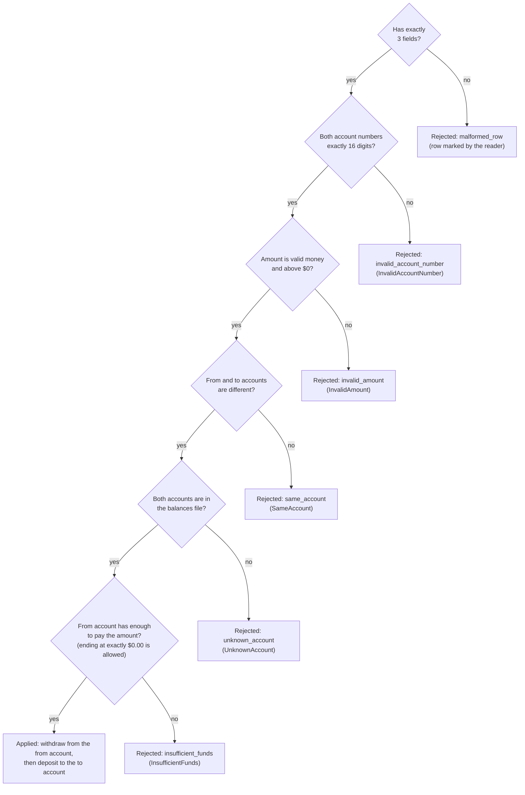

# 7.1 Apply one transfer

The order in which one transfers row is checked, and the point where balances change.

Every row from the transfers file goes through the same six checks, in the order set by [DEC-19](../../design-analysis/design-decisions.md#dec-19). The first check that fails gives the row its one reason code (each "no" leads to the reason code, with the error raised), no later check runs, and both balances stay as they were. Only a row that passes all six changes any balance, and then the withdrawal comes before the deposit, which cannot fail ([DEC-18](../../design-analysis/design-decisions.md#dec-18)). So a transfer is either fully applied or not applied at all.

## The checks in order

The checks run in this order; the first one that fails decides the reason, and no balance changes.

| Order | The row passes if… | If not, it is rejected as | Decision |
|---|---|---|---|
| 1 | it has exactly 3 fields | `malformed_row` | [DEC-04](../../design-analysis/design-decisions.md#dec-04) |
| 2 | both account numbers are exactly 16 digits | `invalid_account_number` | [DEC-08](../../design-analysis/design-decisions.md#dec-08) |
| 3 | the amount is valid money and above $0 | `invalid_amount` | [DEC-09](../../design-analysis/design-decisions.md#dec-09), [DEC-10](../../design-analysis/design-decisions.md#dec-10) |
| 4 | the from and to accounts are different | `same_account` | [DEC-13](../../design-analysis/design-decisions.md#dec-13) |
| 5 | both accounts are in the balances file | `unknown_account` | [DEC-17](../../design-analysis/design-decisions.md#dec-17), [DEC-31](../../design-analysis/design-decisions.md#dec-31) |
| 6 | the from account has enough to pay the amount (ending at exactly $0.00 is allowed) | `insufficient_funds` | [DEC-13](../../design-analysis/design-decisions.md#dec-13) |

Which component makes each check, and the error it raises, is in [Which checks live where](../06-components.md#which-checks-live-where) and the [errors table](../06-components.md#errors-and-who-raises-them) on page 6. The field count is marked by the reader, with no error. `ProcessDailyTransfer` turns each domain error into the reason code on the same row of this table ([DEC-19](../../design-analysis/design-decisions.md#dec-19)). None of them stops the run.

Points the flow depends on:

- `ProcessDailyTransfer` must build both `AccountNumber`s before the `Money`, so a row with a bad account number and a bad amount raises `InvalidAccountNumber` and gets `invalid_account_number`, as the order requires ([DEC-19](../../design-analysis/design-decisions.md#dec-19)).
- `Transfer` must check the amount before it checks that the accounts differ, so a row with both problems raises `InvalidAmount` and gets `invalid_amount`, as the order requires.
- `TransferService` finds both accounts before it calls `withdraw`. A lookup that fails therefore stops the transfer before any balance changes.
- `withdraw` compares the balance with the amount before it changes the balance. If the result would be below $0.00, it raises `InsufficientFunds` and the balance is untouched. Exactly $0.00 passes ([DEC-13](../../design-analysis/design-decisions.md#dec-13)).
- `deposit` cannot fail for a valid transfer (its amount is above $0, [DEC-18](../../design-analysis/design-decisions.md#dec-18)), so once the withdrawal has happened, nothing is left that could leave the transfer half done. Nothing ever needs to be undone.
- A rejected row does not stop the run: the next row is processed ([DEC-14](../../design-analysis/design-decisions.md#dec-14)). Rows are processed once each, in file order ([DEC-15](../../design-analysis/design-decisions.md#dec-15)), and two identical rows are two transfers ([DEC-16](../../design-analysis/design-decisions.md#dec-16)).
- The outcome of every row, applied or rejected, is one `TransferResult` ([DEC-19](../../design-analysis/design-decisions.md#dec-19)).

The sequence diagrams for the main outcomes are on pages [03](03-successful-transfer.md) (applied), [04](04-insufficient-funds.md) (`insufficient_funds`), [05](05-exactly-zero.md) (exactly $0), [06](06-unknown-account.md) (`unknown_account`) and [07](07-unreadable-row.md) (`malformed_row`).

[Back to the overview](README.md)
[Back to the solution design](../README.md)
