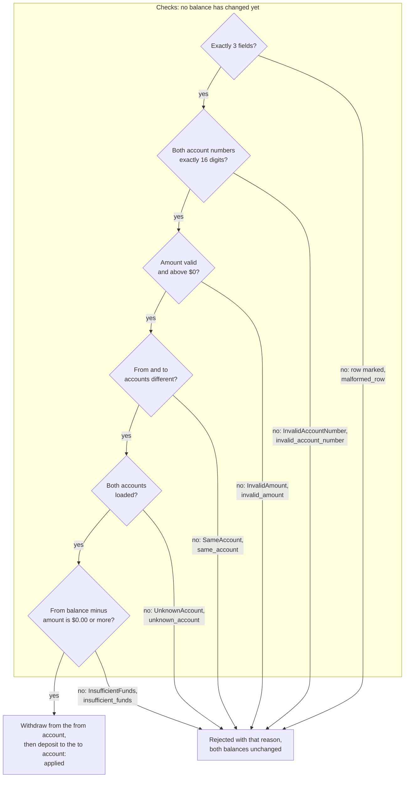

# 7.1 Apply one transfer

The order in which one transfers row is checked, and the point where balances change.

Every row from the transfers file goes through the same six checks, in the order set by [DEC-19](../../design-analysis/design-decisions.md#dec-19). The first check that fails gives the row its one reason code (each arrow below names the error raised, then the reason code), and no later check runs. Only a row that passes all six changes any balance, and then the withdrawal comes before the deposit, which cannot fail ([DEC-18](../../design-analysis/design-decisions.md#dec-18)). So a transfer is either fully applied or not applied at all.

## Where each check lives

| Order | Check | Checked by | Refused with | Reason code | Decision |
|---|---|---|---|---|---|
| 1 | Exactly 3 fields | `TransfersCsvReader` (file-reading layer) | the row is marked; no error is raised | `malformed_row` | [DEC-04](../../design-analysis/design-decisions.md#dec-04) |
| 2 | Both account numbers are 16 digits | `AccountNumber` | `InvalidAccountNumber` | `invalid_account_number` | [DEC-08](../../design-analysis/design-decisions.md#dec-08) |
| 3 | Amount is valid money and above $0 | `Money` for the format, `Transfer` for above $0 | `InvalidAmount`, from either | `invalid_amount` | [DEC-09](../../design-analysis/design-decisions.md#dec-09), [DEC-10](../../design-analysis/design-decisions.md#dec-10) |
| 4 | From and to are different | `Transfer` | `SameAccount` | `same_account` | [DEC-13](../../design-analysis/design-decisions.md#dec-13) |
| 5 | Both accounts are loaded | `AccountRepository` `find` | `UnknownAccount` | `unknown_account` | [DEC-17](../../design-analysis/design-decisions.md#dec-17), [DEC-31](../../design-analysis/design-decisions.md#dec-31) |
| 6 | No overdraft | `Account` `withdraw` | `InsufficientFunds` | `insufficient_funds` | [DEC-13](../../design-analysis/design-decisions.md#dec-13) |

`ProcessDailyTransfer` catches each of these domain errors and turns it into the reason code on the same table row ([DEC-19](../../design-analysis/design-decisions.md#dec-19)). None of them stops the run.

Points the flow depends on:

- `ProcessDailyTransfer` must build both `AccountNumber`s before the `Money`, so a row with a bad account number and a bad amount raises `InvalidAccountNumber` and gets `invalid_account_number`, as the order requires ([DEC-19](../../design-analysis/design-decisions.md#dec-19)).
- `Transfer` must check the amount before it checks that the accounts differ, so a row with both problems raises `InvalidAmount` and gets `invalid_amount`, as the order requires.
- `TransferService` finds both accounts before it calls `withdraw`. A lookup that fails therefore stops the transfer before any balance changes.
- `withdraw` compares the balance with the amount before it changes the balance. If the result would be below $0.00, it raises `InsufficientFunds` and the balance is untouched. Exactly $0.00 passes ([DEC-13](../../design-analysis/design-decisions.md#dec-13)).
- `deposit` cannot fail, so once the withdrawal has happened, nothing is left that could leave the transfer half done. Nothing ever needs to be undone.
- A rejected row does not stop the run: the next row is processed ([DEC-14](../../design-analysis/design-decisions.md#dec-14)). Rows are processed once each, in file order ([DEC-15](../../design-analysis/design-decisions.md#dec-15)), and two identical rows are two transfers ([DEC-16](../../design-analysis/design-decisions.md#dec-16)).
- The outcome of every row, applied or rejected, is one `TransferResult` ([DEC-19](../../design-analysis/design-decisions.md#dec-19)).

The sequence diagrams for the main outcomes are on pages [03](03-successful-transfer.md) (applied), [04](04-insufficient-funds.md) (`insufficient_funds`), [05](05-exactly-zero.md) (exactly $0), [06](06-unknown-account.md) (`unknown_account`) and [07](07-unreadable-row.md) (`malformed_row`).

[Back to the overview](README.md)
[Back to the solution design](../README.md)
