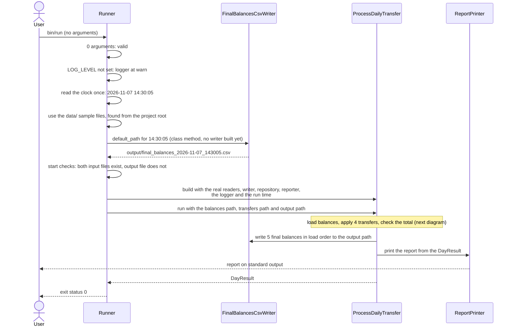
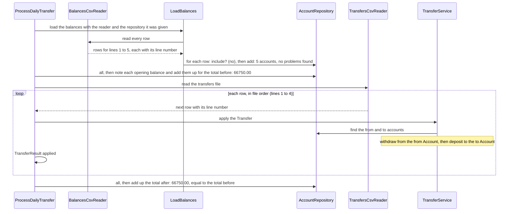

# 7.2 Sample files end to end

The whole run on the challenge's two sample files, from `bin/run` to exit status 0.

The command is `bin/run` with no arguments, so the runner uses the copies of the sample files in `data/` and the default output path ([DEC-22](../../design-analysis/design-decisions.md#dec-22), [DEC-27](../../design-analysis/design-decisions.md#dec-27)). The flow is split in two diagrams: the runner's view, then the day's work inside `ProcessDailyTransfer`.

## The runner's view

## Inside the day

- Both files are read one row at a time, and every row of the balances file is read and checked before any transfer is read ([DEC-32](../../design-analysis/design-decisions.md#dec-32)). Each transfer follows the flow on [page 03](03-successful-transfer.md). The total check is [DEC-24](../../design-analysis/design-decisions.md#dec-24).

## Balances after each transfer

| After | 1111234522226789 | 1111234522221234 | 2222123433331212 | 1212343433335665 | 3212343433335755 |
|---|---:|---:|---:|---:|---:|
| Loading | 5000.00 | 10000.00 | 550.00 | 1200.00 | 50000.00 |
| Line 1: 500.00 from 1111234522226789 to 1212343433335665 | 4500.00 | 10000.00 | 550.00 | 1700.00 | 50000.00 |
| Line 2: 1000.00 from 3212343433335755 to 2222123433331212 | 4500.00 | 10000.00 | 1550.00 | 1700.00 | 49000.00 |
| Line 3: 320.50 from 3212343433335755 to 1111234522226789 | 4820.50 | 10000.00 | 1550.00 | 1700.00 | 48679.50 |
| Line 4: 25.60 from 1111234522221234 to 1212343433335665 | 4820.50 | 9974.40 | 1550.00 | 1725.60 | 48679.50 |

All four transfers are applied. The last row is the closing balance of every account, as [DEC-35](../../design-analysis/design-decisions.md#dec-35) requires, and the total stays 66750.00. The output file holds these five balances in load order, and standard error stays empty at the default log level ([DEC-28](../../design-analysis/design-decisions.md#dec-28)). The exact report is in [Functional requirements](../02-functional-requirements.md); [page 09](09-run-output-and-exit-code.md) shows the order of the outputs.

[Back to the overview](README.md)
[Back to the solution design](../README.md)
