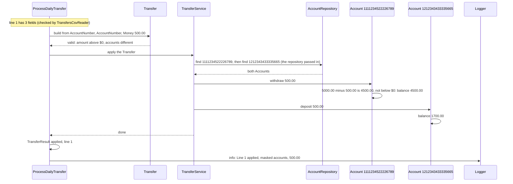

# 7.3 A successful transfer

One valid transfers row, from the row to an applied `TransferResult`.

**Example.** The balances are the sample balances. Line 1 of the transfers file is `1111234522226789,1212343433335665,500.00`. Account 1111234522226789 holds 5000.00 and account 1212343433335665 holds 1200.00.

Steps:

1. `ProcessDailyTransfer` builds two `AccountNumber`s and one `Money` from the row's fields, then the `Transfer`. Each of these checks its own rule as it is built ([DEC-30](../../design-analysis/design-decisions.md#dec-30)). Had one refused, it would have raised `InvalidAccountNumber`, `InvalidAmount` or `SameAccount`, and the row would have been rejected before `TransferService` was called ([page 01](01-apply-one-transfer.md)).
2. `TransferService` finds both accounts before it changes anything ([DEC-18](../../design-analysis/design-decisions.md#dec-18), [DEC-31](../../design-analysis/design-decisions.md#dec-31)).
3. `withdraw` checks the balance, then changes it. `deposit` cannot fail.
4. The result is one `TransferResult`, applied ([DEC-19](../../design-analysis/design-decisions.md#dec-19)). At the end of the run, `ProcessDailyTransfer` prints it through the reporter as the report line `Line 1  applied  1111234522226789 -> 1212343433335665  500.00`.
5. The info log line masks both account numbers: `Line 1 applied: ************6789 -> ************5665 500.00` ([DEC-28](../../design-analysis/design-decisions.md#dec-28), [DEC-29](../../design-analysis/design-decisions.md#dec-29)). At the default level (warn) it is not written.

The total of all balances does not change: 500.00 left one account and 500.00 arrived in the other. The order of all checks is on [page 01](01-apply-one-transfer.md).

[Back to the overview](README.md)
[Back to the solution design](../README.md)
