# 7.4 A transfer that would go below $0

A transfer that would take the paying account below $0 is rejected, and both balances stay as they were.

**Example.** The balances are the sample balances. The transfers file has lines 1 and 2 of the sample file, then line 3 is `1111234522226789,1212343433335665,9000.00`. After line 1, account 1111234522226789 holds 4500.00 and account 1212343433335665 holds 1700.00.

```mermaid
sequenceDiagram
    participant P as ProcessDailyTransfer
    participant TS as TransferService
    participant Repo as AccountRepository
    participant A as Account 1111234522226789
    participant B as Account 1212343433335665
    participant L as Logger
    Note over P: line 3 passes checks 1 to 4 (fields, account numbers, amount, different accounts)
    P->>TS: apply the Transfer for 9000.00
    TS->>Repo: find 1111234522226789, then find 1212343433335665
    Repo-->>TS: both Accounts
    TS->>A: withdraw 9000.00
    A->>A: 4500.00 minus 9000.00 is below $0
    A-->>TS: raises InsufficientFunds, balance still 4500.00
    Note over TS,B: deposit is never called: balance still 1700.00
    TS-->>P: InsufficientFunds
    P->>P: TransferResult rejected, insufficient_funds, line 3
    P->>L: warn: Line 3 rejected, masked accounts, 9000.00 insufficient_funds
    Note over P: the run continues with the next row, if there is one
```

What makes the balances safe:

- `withdraw` compares first and changes the balance only when the result is $0.00 or more ([DEC-13](../../design-analysis/design-decisions.md#dec-13)). Here it raises `InsufficientFunds` before touching the balance.
- The deposit comes after the withdrawal, so it is never reached ([DEC-18](../../design-analysis/design-decisions.md#dec-18)). Nothing has to be undone.
- `ProcessDailyTransfer` turns the error into a rejected `TransferResult` with the reason `insufficient_funds`, the last check in [DEC-19](../../design-analysis/design-decisions.md#dec-19), and moves on to the next row ([DEC-14](../../design-analysis/design-decisions.md#dec-14)).
- The row is never retried, even if a later row pays enough into the account ([DEC-15](../../design-analysis/design-decisions.md#dec-15)).

Visible results:

- Report line, printed through the reporter at the end of the run: `Line 3  rejected  1111234522226789 -> 1212343433335665  9000.00  insufficient_funds`
- Log line on standard error, shown at the default level: `W, [<timestamp> #<pid>]  WARN -- : Line 3 rejected: ************6789 -> ************5665 9000.00 insufficient_funds` ([DEC-28](../../design-analysis/design-decisions.md#dec-28), [DEC-29](../../design-analysis/design-decisions.md#dec-29))
- After line 3, both accounts still hold 4500.00 and 1700.00.
- The run completes with exit status 0 ([DEC-25](../../design-analysis/design-decisions.md#dec-25)).

[Back to the overview](README.md)
[Back to the solution design](../README.md)
