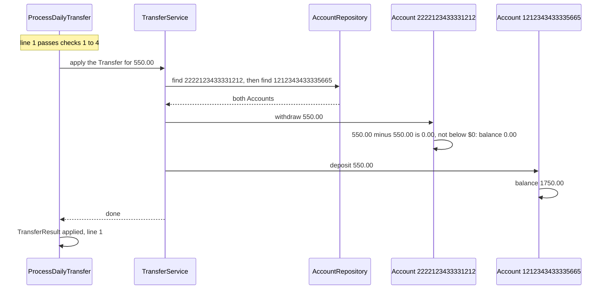

# 7.5 A transfer that leaves exactly $0

A transfer that leaves the paying account at exactly $0.00 is applied, because only going below $0 is refused.

**Example.** The balances are the sample balances. Line 1 of the transfers file is `2222123433331212,1212343433335665,550.00`. Account 2222123433331212 holds exactly 550.00, and account 1212343433335665 holds 1200.00.

The rule `withdraw` applies is "the balance minus the amount is $0.00 or more" ([DEC-13](../../design-analysis/design-decisions.md#dec-13)). The comparison is exact, because both values are `Money` on `BigDecimal` ([DEC-09](../../design-analysis/design-decisions.md#dec-09)), so 550.00 minus 550.00 is exactly 0.00 and the transfer passes.

Visible results:

- Report line, printed through the reporter at the end of the run: `Line 1  applied  2222123433331212 -> 1212343433335665  550.00`
- The output file holds `2222123433331212,0.00` and `1212343433335665,1750.00`. A balance of 0.00 is a valid starting balance for the next day's run ([DEC-10](../../design-analysis/design-decisions.md#dec-10), [DEC-27](../../design-analysis/design-decisions.md#dec-27)).
- If a later row then asks for 0.01 from 2222123433331212, that row is rejected with `insufficient_funds`, as on [page 04](04-insufficient-funds.md).

[Back to the overview](README.md)
[Back to the solution design](../README.md)
