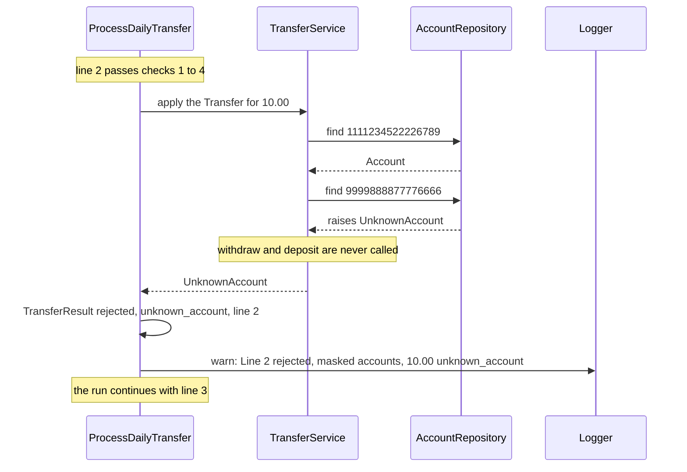

# 7.6 A transfer naming an unknown account

A transfer whose from or to account is not in the balances file is rejected, no balance changes and no account is created.

An *unknown account* is a valid 16-digit account number that the balances file does not list ([DEC-17](../../design-analysis/design-decisions.md#dec-17)). A number that is not 16 digits is rejected earlier, as `invalid_account_number` ([DEC-19](../../design-analysis/design-decisions.md#dec-19)).

**Example.** The balances are the sample balances. Line 2 of the transfers file is `1111234522226789,9999888877776666,10.00`. Account 9999888877776666 is not in the balances file.

How it works:

- `AccountRepository` is the one place that knows which accounts exist. `find` raises `UnknownAccount` for a number it does not hold, and it never adds an account ([DEC-31](../../design-analysis/design-decisions.md#dec-31)).
- The failed lookup stops the transfer before any balance changes ([page 01](01-apply-one-transfer.md), [DEC-18](../../design-analysis/design-decisions.md#dec-18)): account 1111234522226789 keeps the balance it had before line 2.
- The reason is `unknown_account` whether the from account, the to account or both are unknown.
- `ProcessDailyTransfer` turns the error into a rejected `TransferResult` and processes the next row ([DEC-14](../../design-analysis/design-decisions.md#dec-14)).

Visible results:

- Report line, printed through the reporter at the end of the run: `Line 2  rejected  1111234522226789 -> 9999888877776666  10.00  unknown_account`
- Log line, shown at the default level: `W, [<timestamp> #<pid>]  WARN -- : Line 2 rejected: ************6789 -> ************6666 10.00 unknown_account` ([DEC-29](../../design-analysis/design-decisions.md#dec-29))
- The output file lists only the five loaded accounts. The total of all balances is unchanged.

[Back to the overview](README.md)
[Back to the solution design](../README.md)
