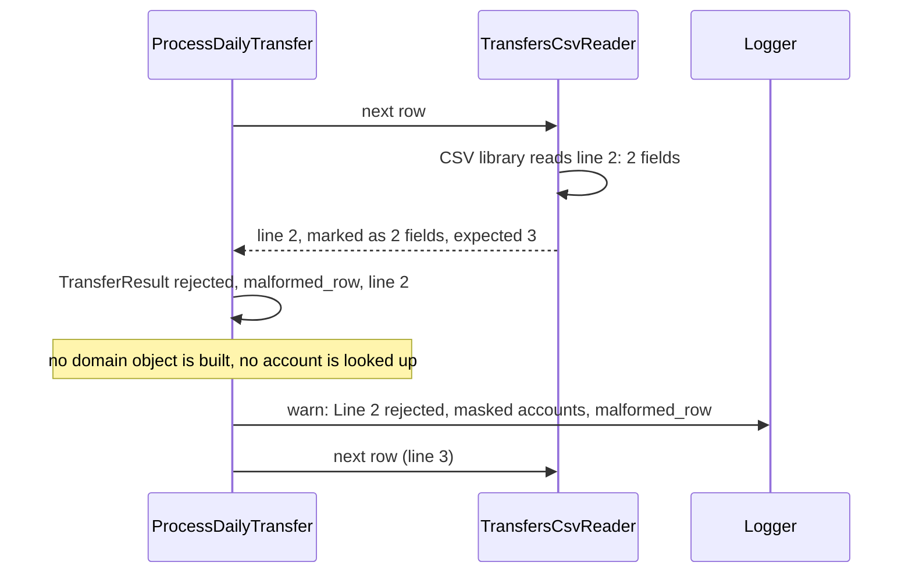
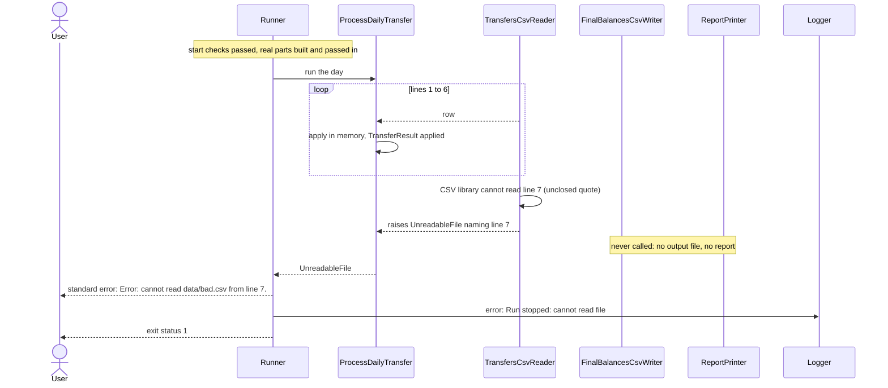

# 7.7 A row that cannot be read

The two ways a transfers row can fail to be read: a row with the wrong number of fields is rejected and the run continues, while a file the CSV library cannot read past stops the run.

The difference: in the first case the CSV library reads the row, but the row has the wrong shape. In the second, the library itself cannot go on, so no later row can be trusted ([DEC-04](../../design-analysis/design-decisions.md#dec-04)).

## A row with the wrong number of fields

**Example.** Line 2 of the transfers file is `3212343433335755,2222123433331212`: 2 fields instead of 3.

- The field count is the first check ([DEC-19](../../design-analysis/design-decisions.md#dec-19)) and belongs to the file-reading layer, which checks only the shape of a row. Nothing in the domain sees the row, so no balance can change ([DEC-14](../../design-analysis/design-decisions.md#dec-14)).
- Report line: `Line 2  rejected  malformed_row: 2 fields, expected 3`
- Log line, shown at the default level: `W, [<timestamp> #<pid>]  WARN -- : Line 2 rejected: ************5755 -> ************1212 malformed_row`. The amount is left out because the row has no third field ([DEC-28](../../design-analysis/design-decisions.md#dec-28)).
- A row of only commas, such as `,,`, has 3 empty fields, so it passes this check and fails the next one ([DEC-05](../../design-analysis/design-decisions.md#dec-05)). A blank line is skipped and is not a row.
- In the balances file, a row with the wrong number of fields is one more problem in the `InvalidBalancesFile` error that makes the whole file invalid ([DEC-11](../../design-analysis/design-decisions.md#dec-11), [DEC-12](../../design-analysis/design-decisions.md#dec-12)).

## A file the CSV library cannot read past

**Example.** `bin/run data/mable_account_balances.csv data/bad.csv`. Lines 1 to 6 of `data/bad.csv` are valid transfers. Line 7 opens a quoted value that is never closed.

- The in-memory changes from lines 1 to 6 are discarded, because nothing is written. A half-applied day never reaches a file ([DEC-04](../../design-analysis/design-decisions.md#dec-04), [DEC-25](../../design-analysis/design-decisions.md#dec-25)).
- The full message on standard error is `Error: cannot read data/bad.csv from line 7. Check for an unclosed quote or characters that are not text.` The line number is where the unreadable row starts ([DEC-07](../../design-analysis/design-decisions.md#dec-07)).
- `ProcessDailyTransfer` does not catch `UnreadableFile`, so it reaches the `Runner`, which prints the message, logs one error line and exits with status 1 ([DEC-25](../../design-analysis/design-decisions.md#dec-25)).
- Bytes that are not valid UTF-8 text stop the run the same way.
- In the balances file, `BalancesCsvReader` gives `LoadBalances` the rows before the unreadable line, then raises `UnreadableFile`. `LoadBalances` catches it, reports the problems found in those rows, then the unreadable line as the last problem, all in one `InvalidBalancesFile` error. No transfer is applied ([DEC-12](../../design-analysis/design-decisions.md#dec-12)).

Exact messages are in [Functional requirements](../02-functional-requirements.md). The order of outputs when a run stops is on [page 09](09-run-output-and-exit-code.md).

[Back to the overview](README.md)
[Back to the solution design](../README.md)
