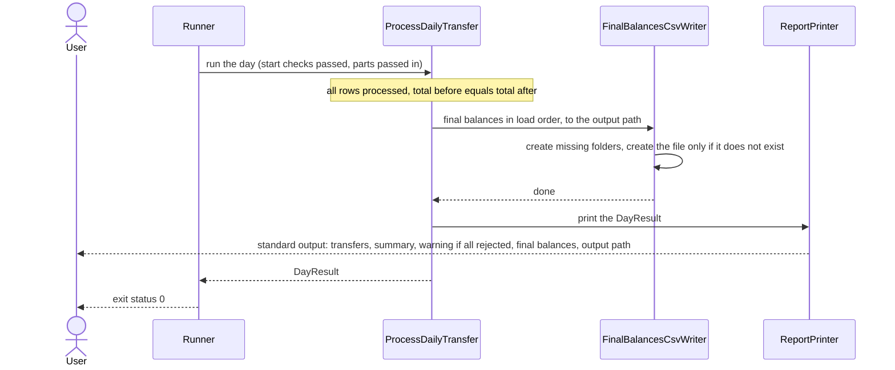
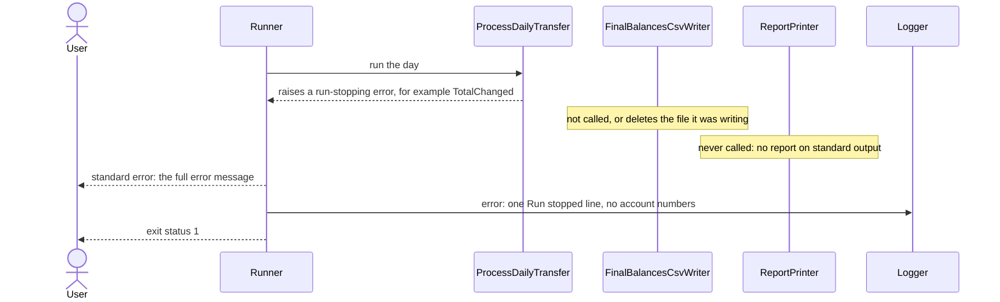

# 7.9 Run output and exit code

The order in which a run produces its output file, its report and its exit status, for a completed run and for a run that stops.

A run has three outputs: the output CSV file, standard output, which carries only the report, and standard error, which carries log lines and error messages. It ends with an exit status of 0 or 1 ([DEC-25](../../design-analysis/design-decisions.md#dec-25)). These terms are defined in the [glossary](../10-traceability-glossary-assumptions.md#glossary).

## A completed run

- `ProcessDailyTransfer` writes the output file, then prints the report through the reporter it was given ([DEC-26](../../design-analysis/design-decisions.md#dec-26)), so the report's last line names a file that already exists. The `Runner` never prints the report.
- The report sections come in the order of [DEC-26](../../design-analysis/design-decisions.md#dec-26). The all-rejected warning appears only when every row was rejected, and the run still exits with 0 ([DEC-21](../../design-analysis/design-decisions.md#dec-21)).
- Standard error carries only log lines, at the levels in the [stream table on page 9](../09-considerations.md#standard-output-standard-error-and-exit-codes). With the sample files at the default level it stays empty.

## A run that stops

- The `Runner` catches only the five run-stopping errors in the [errors table on page 6](../06-components.md#errors-and-who-raises-them) ([DEC-25](../../design-analysis/design-decisions.md#dec-25)). Domain errors such as `InsufficientFunds` never reach it, because `ProcessDailyTransfer` turns them into rejected transfers ([DEC-14](../../design-analysis/design-decisions.md#dec-14)).
- Every stop ends in the order shown: the full message on standard error as plain text, then one log line at error level, then exit status 1 ([DEC-25](../../design-analysis/design-decisions.md#dec-25), [DEC-28](../../design-analysis/design-decisions.md#dec-28)). Only the usage message has no log line, because the run never started (assistant's pick).
- The run never creates or leaves an output file, and an output file that already existed is not changed ([DEC-25](../../design-analysis/design-decisions.md#dec-25)). If writing fails partway, `FinalBalancesCsvWriter` deletes the partial file ([DEC-27](../../design-analysis/design-decisions.md#dec-27)).
- A failed total check raises `TotalChanged` before the writer is called ([DEC-24](../../design-analysis/design-decisions.md#dec-24)).

Which situation gives which exit status, and what each one writes to standard error, is in the [exit code table on page 9](../09-considerations.md#standard-output-standard-error-and-exit-codes).

The exact text of every message is in [Functional requirements](../02-functional-requirements.md). Error handling by layer is in [Considerations](../09-considerations.md).

[Back to the overview](README.md)
[Back to the solution design](../README.md)
