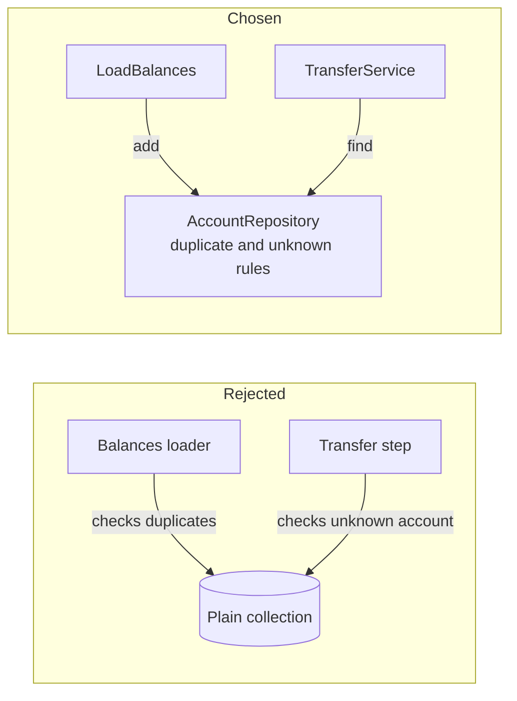

# 8.2 Alternatives: accounts and the aggregate root

How else the accounts could have been held and the domain structured, and why a thin in-memory repository and light domain-driven design (DDD: modelling the code on the business's own terms and rules, without the full set of DDD patterns) were chosen.

The chosen design: `Account` is the aggregate root, the one model that owns a balance and guards the no-overdraft rule. A thin in-memory `AccountRepository` holds the accounts and is the one place for the duplicate and unknown-account rules ([DEC-30](../../design-analysis/design-decisions.md#dec-30), [DEC-31](../../design-analysis/design-decisions.md#dec-31)). The full component descriptions are in [Components](../06-components.md).

## No repository: a plain collection passed around

**Description.** Keep the accounts in a plain collection (for example a Ruby Hash, a lookup table, keyed by account number), created by the balances loader and handed to the transfer step. Each part that uses it checks for duplicates or missing accounts itself.

**Pros**
- One class fewer.
- Uses a native data structure directly, which the rubric also values.

**Cons**
- The duplicate rule and the unknown-account rule are spread across the loader and the transfer step, so each must handle them and each must be tested for them.
- A test cannot swap in a fake store as easily, for example the fake repository whose total changes, used to test the total check ([DEC-24](../../design-analysis/design-decisions.md#dec-24)).

**Cost.** With a lookup keyed by account number, finding an account is O(1) and holding the accounts is O(n) space in both designs. The difference is where the rules live, not speed.

**Why not chosen.** With a repository, the rules stay in one place; otherwise the balances loader and the transfer step would each need to handle them ([DEC-31](../../design-analysis/design-decisions.md#dec-31)).

## Full domain-driven design

**Description.** Use the complete vocabulary and structure of DDD: base classes such as `AggregateRoot` or `ValueObject`, name suffixes, domain events, factories, commands, data transfer objects (DTOs, plain data carriers between layers) and mappers.

**Pros**
- Familiar to teams that already work this way.
- Gives a ready place for features a larger system might need, such as events for an audit trail.

**Cons**
- Many more classes and files for a program with a handful of rules.
- The ceremony hides the few rules that matter, which works against the rubric's "short methods" and "readable methods".
- Events, factories and mappers would have nothing to do in a single in-memory run.

**Cost.** No difference in time or space for the work itself; the cost is in code size and reading time.

**Why not chosen.** Full DDD terms and structure are heavy for a small program. Light DDD keeps the thinking, with rules inside plain-named models such as `Account`, `Money` and `Transfer`, without the ceremony ([DEC-30](../../design-analysis/design-decisions.md#dec-30)).

## Account numbers as integers

**Description.** Store each account number as a whole number instead of text.

**Pros**
- Slightly smaller in memory, and simple to compare.

**Cons**
- A number starting with 0 would lose its leading zeros and stop matching between the two files.

**Why not chosen.** Account numbers are kept as text so leading zeros are kept ([DEC-08](../../design-analysis/design-decisions.md#dec-08)).

[Back to the overview](README.md)
[Back to the solution design](../README.md)
