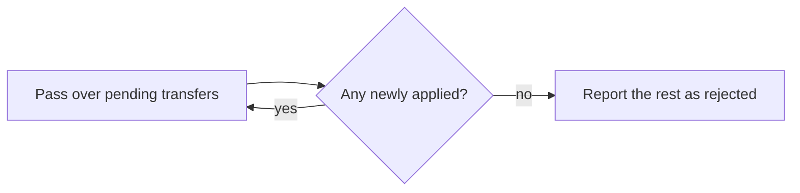

# 8.3 Alternatives: errors and rejected transfers

How else bad transfers and bad balance rows could have been handled, and why the chosen rules were picked.

The chosen design: a bad transfer is rejected with one reason code and the run continues, in one pass in file order. Unknown accounts are rejected, never created, and every row is a separate transfer. A balances file with any problem stops the run after every problem is reported ([DEC-12](../../design-analysis/design-decisions.md#dec-12), [DEC-14](../../design-analysis/design-decisions.md#dec-14) to [DEC-17](../../design-analysis/design-decisions.md#dec-17), [DEC-19](../../design-analysis/design-decisions.md#dec-19)). The flows are in [Logical flow](../07-logical-flow/README.md); error handling by layer is in [Considerations](../09-considerations.md).

## Stopping the run on a bad transfer

**Description.** Treat the first rejected transfer as fatal: stop, write nothing, exit with status 1.

**Pros**
- Nothing is applied from a file that has any problem.
- One rule for every error.

**Cons**
- One bad row blocks the rest of the company's day.
- The user learns about one bad row per run.
- A rejection for too little balance is a normal business outcome, not a broken file.

**Cost.** The same O(n) time over n transfers, or less when it stops early.

**Why not chosen.** One bad row must not block the rest of the day; the row is rejected with a reason and the next one is processed ([DEC-14](../../design-analysis/design-decisions.md#dec-14), [DEC-17](../../design-analysis/design-decisions.md#dec-17)).

## Retrying rejected transfers

**Description.** After the first pass, try the rejected transfers again, in case a later transfer paid enough into the account. Repeat until a pass applies nothing new.

**Pros**
- More transfers are applied when the file's order is unlucky.

**Cons**
- Results depend on retry rules (how many passes, in what order), which are harder to explain and to test.
- The final balances no longer follow the file's order, which is the order the company intends.

**Cost.** Up to n passes over n transfers, so O(n²) time in the worst case, against O(n) for one pass. O(n) space to keep the pending transfers.

**Why not chosen.** One pass in file order is simple and predictable ([DEC-15](../../design-analysis/design-decisions.md#dec-15)). Any other order, such as credits first, was also rejected: it changes the meaning of the file ([DEC-15](../../design-analysis/design-decisions.md#dec-15)).

## Creating unknown accounts

**Description.** When a transfer's to account is a valid account number that is not in the balances file, create that account with a $0.00 balance and apply the transfer.

**Pros**
- Fewer rejected transfers into new accounts.

**Cons**
- Invents accounts the company never provided.
- A typing mistake in an account number silently creates a new account and sends money to it.
**Cost.** O(1) per new account, plus its space.

**Why not chosen.** Accounts are never created; a transfer naming an unknown account is rejected with `unknown_account`, and the total of all balances stays the same ([DEC-17](../../design-analysis/design-decisions.md#dec-17)).

## Duplicate transfer detection

**Description.** Reject, or warn about, a transfer that repeats an earlier row: the same from account, to account and amount. A stricter form rejects any repeated from/to pair whatever the amount.

**Pros**
- Catches a row pasted twice by mistake.

**Cons**
- Two equal payments between the same accounts on one day are realistic, and would be blocked.
- No rule can tell a real repeat from a mistake using the file alone.

**Cost.** O(n) extra space to remember every row seen; O(1) time per check with a lookup.

**Why not chosen.** Every row is a separate transfer, as a bank treats it ([DEC-16](../../design-analysis/design-decisions.md#dec-16)).

## Loading only the valid balance rows

**Description.** Skip the bad rows of the balances file, load the good ones, and run the transfers.

**Pros**
- The day still runs when the balances file has a small problem.

**Cons**
- Transfers touching a skipped account fail as unknown, which hides the real cause.
- Money moves on doubtful opening balances.

**Cost.** The same as the chosen design: O(m) time and space over m balance rows.

**Why not chosen.** Every problem is reported, with its line number, and then the run stops, so nothing runs on doubtful balances ([DEC-11](../../design-analysis/design-decisions.md#dec-11), [DEC-12](../../design-analysis/design-decisions.md#dec-12)). Stopping at the first bad row was also rejected: the user could fix only one problem per run ([DEC-12](../../design-analysis/design-decisions.md#dec-12)).

## Other rejected options in this area

| Option | Why not chosen |
|---|---|
| For a duplicate balance row, letting the last row win, or adding the balances together | Hides an error, or guesses what was meant ([DEC-11](../../design-analysis/design-decisions.md#dec-11)) |
| A rollback mechanism, database transactions or sagas | Every check runs before any balance changes, so there is nothing to undo ([DEC-18](../../design-analysis/design-decisions.md#dec-18)) |
| Counting only applied and rejected, with no reason codes | A reason per rejection gives clearer feedback at little cost ([DEC-19](../../design-analysis/design-decisions.md#dec-19)) |
| Treating an empty transfers file as a day with nothing to do | It is almost certainly the wrong file ([DEC-20](../../design-analysis/design-decisions.md#dec-20)) |
| Exit status 1 when every transfer is rejected | The file was read and every row dealt with, so the run completed; a warning is shown instead ([DEC-21](../../design-analysis/design-decisions.md#dec-21)) |

[Back to the overview](README.md)
[Back to the solution design](../README.md)
