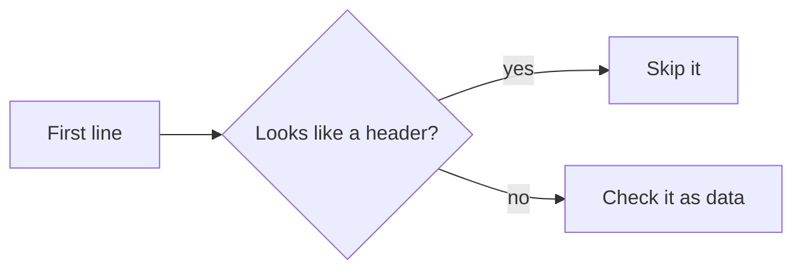

# 8.4 Alternatives: reading files

How else the two CSV files could have been read, and why Ruby's CSV library with no header detection and row-by-row reading was chosen.

The chosen design: both files are read with Ruby's standard CSV library, with no header row. A header line fails like any other bad row, with a hint in the message. The transfers file is read one row at a time; the balances file is read in full. A file the library cannot read past some line stops the run ([DEC-04](../../design-analysis/design-decisions.md#dec-04), [DEC-06](../../design-analysis/design-decisions.md#dec-06), [DEC-32](../../design-analysis/design-decisions.md#dec-32)). The readers are described in [Components](../06-components.md).

## Header detection

**Description.** Look at the first line of each file. If it looks like a header (for example `from,to,amount`), skip it instead of treating it as data.

**Pros**
- A file exported with a header still runs without editing.

**Cons**
- Needs a rule for recognising a header, and that rule can be wrong.
- A real first row with a data error could be taken for a header and skipped silently.
- Headers are not part of the format: the sample files have none.

**Cost.** O(1) extra work for one line.

**Why not chosen.** There is no header detection. A header line is checked like any other row and fails, with the message `This looks like a header row; files must not have a header.`, so the user can fix the file in seconds ([DEC-06](../../design-analysis/design-decisions.md#dec-06)). Skipping a header in the balances file only was also rejected: two rules for the same thing.

## A hand-written parser

**Description.** Split each line on commas with the solution's own code instead of using the CSV library.

**Pros**
- No dependency on the CSV library's behaviour.
- Full control over every error message.

**Cons**
- Quoted values, Windows (CRLF) line endings, a missing final newline and a byte-order mark (an invisible marker some editors put at the start of a file) all need handling and tests.
- More code, more chances of a parsing bug, and no gain for the rubric.

**Cost.** O(m + n) time over the lines of both files, in both designs.

**Why not chosen.** A standard parser already handles the awkward parts of CSV correctly ([DEC-04](../../design-analysis/design-decisions.md#dec-04)).

## Reading the transfers file line by line

**Description.** Read the transfers file as plain text lines and parse each line on its own, so a line the CSV library cannot read is rejected as one bad transfer and the run continues.

**Pros**
- One broken line no longer stops the whole day.

**Cons**
- More code: the solution would do the line splitting the library already does.
- A quoted value that contains a newline spans two lines, so splitting on lines can break a valid row.
- It replaces the row-by-row reading the decisions chose ([DEC-32](../../design-analysis/design-decisions.md#dec-32)).

**Cost.** O(n) time over the n lines of the transfers file, O(1) space per line: the same as the chosen design.

**Why not chosen.** An unreadable file stops the run instead, which avoids a half-applied day ([DEC-04](../../design-analysis/design-decisions.md#dec-04)). Keeping the transfers applied before the unreadable line was rejected for the same reason: it would be a partial day.

## Streaming, chunking or background processing

**Description.** Process very large files in fixed-size chunks, under a memory limit, or in background jobs. Streaming here means a pipeline that also writes each result out as it goes and keeps nothing for the end. The chosen design already reads the transfers file one row at a time, but keeps the results for the report.

**Pros**
- Copes with files far larger than one company's day.

**Cons**
- Complexity with no stated need: one company's daily transfers are small.
- The transfers file is already read one row at a time, so it is never held in memory as a whole.
- The balances file must be read in full anyway, because all its errors must be found before any transfer runs ([DEC-12](../../design-analysis/design-decisions.md#dec-12)).
- The report lists every transfer, so the transfer results are kept until the end in any design that prints that report ([DEC-26](../../design-analysis/design-decisions.md#dec-26)).

**Cost.** Chosen design: O(m) space for the m accounts, and O(n) space for the n transfer results kept for the report; the transfers file itself is never fully in memory. Chunking would not lower this without changing the report.

**Why not chosen.** Reading row by row costs nothing extra and already copes with a larger file ([DEC-32](../../design-analysis/design-decisions.md#dec-32)). The README lists very large files as a production item ([DEC-37](../../design-analysis/design-decisions.md#dec-37)); scale is discussed in [Considerations](../09-considerations.md).

[Back to the overview](README.md)
[Back to the solution design](../README.md)
