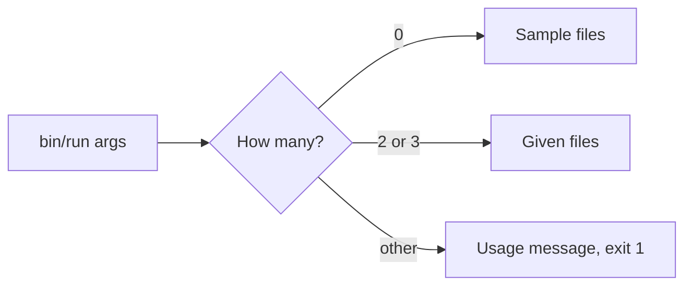

# 8.5 Alternatives: output and the runner

How else the output file, the command line and the report could have worked, and why the chosen forms were picked.

The chosen design: `bin/run` takes 0, 2 or 3 positional arguments. Each completed run writes a new output file and never overwrites one. By default the file is named with the run's date and time; a third argument gives the full path, used as given. The report lists every transfer, a summary, the final balances and the output path ([DEC-22](../../design-analysis/design-decisions.md#dec-22), [DEC-25](../../design-analysis/design-decisions.md#dec-25) to [DEC-27](../../design-analysis/design-decisions.md#dec-27)). The exact report and messages are in [Functional requirements](../02-functional-requirements.md).

## Overwriting one fixed output file

**Description.** Always write the final balances to the same file, for example `output/final_balances.csv`, replacing what is there.

**Pros**
- One predictable path; no old files build up.

**Cons**
- A second run destroys the first run's result, which may be the next day's balances file.
- Two runs that overlap write to the same file.

**Why not chosen.** An existing file is never overwritten; the run stops with an error and the file is not changed ([DEC-25](../../design-analysis/design-decisions.md#dec-25), [DEC-27](../../design-analysis/design-decisions.md#dec-27)).

## A date-only file name

**Description.** Name the file with the date only, for example `final_balances_2026-11-07.csv`.

**Pros**
- Shorter name; one file per day matches "one day's transfers".

**Cons**
- A second run on the same day collides with the first, and then stops because the file exists.

**Why not chosen.** The name carries the time as well, `final_balances_2026-11-07_143005.csv`, so two runs never collide ([DEC-27](../../design-analysis/design-decisions.md#dec-27)).

## A `--force` option

**Description.** Add an option that allows an existing output file to be overwritten.

**Pros**
- A user can rerun into the same path on purpose.

**Cons**
- One more option to parse, document and test.
- Makes it easy to lose a result by habit.

**Why not chosen.** Every run writes its own file, so there is nothing to force ([DEC-27](../../design-analysis/design-decisions.md#dec-27)). A user who wants a given name passes it as the third argument.

## Named command-line options

**Description.** Take the files as named options, for example `--balances data/b.csv --transfers data/t.csv`.

*The chosen positional form, shown for comparison: the argument count alone decides what happens.*

**Pros**
- Arguments can be given in any order, and each one says what it is.
- Room for more options later.

**Cons**
- Needs an option parser, its errors and its help text.
- More to type for a program with two or three file paths.

**Why not chosen.** Positional arguments are the simplest way to pass two or three files ([DEC-22](../../design-analysis/design-decisions.md#dec-22)). A separate help option that exits with 0 was also rejected; `-h` and `--help` show the usage message like any wrong argument count.

## Other report contents

**Description.** Variations on what the screen report shows.

| Option | Pros | Cons, and why not chosen |
|---|---|---|
| List only the rejected transfers | Shorter report | The user cannot check every row against the file ([DEC-26](../../design-analysis/design-decisions.md#dec-26)) |
| Leave out the final balances, because they are in the output CSV | Shorter report | "Runs and provides feedback" is a rubric item; the user sees the result at once ([DEC-26](../../design-analysis/design-decisions.md#dec-26)) |
| Show only the closing balances, without the opening balances | Narrower table | The user would need the balances file to check the day ([DEC-26](../../design-analysis/design-decisions.md#dec-26)) |
| Show each account's balance after every transfer line | Shows each step | Long and repetitive; the opening and closing balances are enough to check the day ([DEC-26](../../design-analysis/design-decisions.md#dec-26)) |
| Mask account numbers on screen | Hides full numbers | Harder to check the result by eye; masking is for logs only ([DEC-26](../../design-analysis/design-decisions.md#dec-26), [DEC-29](../../design-analysis/design-decisions.md#dec-29)) |
| Show the output path as typed, or relative to the project root | No path work | Wrong when the command is run from another folder ([DEC-26](../../design-analysis/design-decisions.md#dec-26)) |
| Always show the full output path | Never ambiguous | Long; the path relative to the current folder is enough ([DEC-26](../../design-analysis/design-decisions.md#dec-26)) |

**Cost.** None of these changes the growth rate: the report is O(n + m) for n transfers and m accounts.

## Other rejected options in this area

| Option | Why not chosen |
|---|---|
| Reading the sample files straight from `docs/challenge/` | The challenge files are kept unchanged; `data/` holds copies ([DEC-22](../../design-analysis/design-decisions.md#dec-22)) |
| A non-zero exit status when some transfers are rejected | A rejected transfer is a normal part of a day ([DEC-25](../../design-analysis/design-decisions.md#dec-25)) |
| Treating a run with no arguments differently for the output file | One rule for every run ([DEC-27](../../design-analysis/design-decisions.md#dec-27)) |
| Checking the total of all balances only in tests, or in a separate class | A run-time check is a safety net; a separate class is one more class ([DEC-24](../../design-analysis/design-decisions.md#dec-24)) |

[Back to the overview](README.md)
[Back to the solution design](../README.md)
