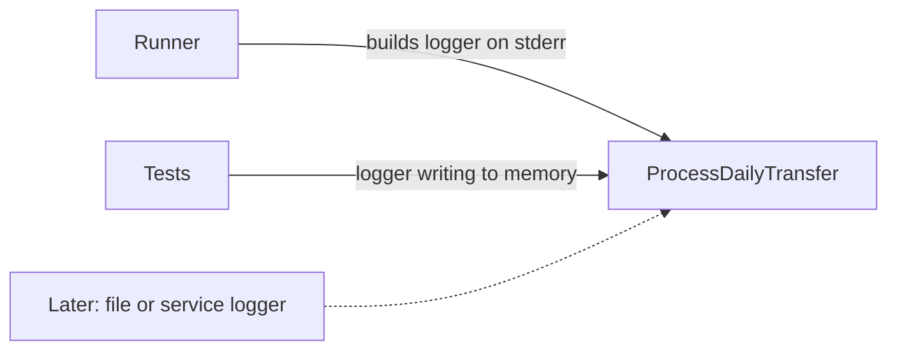

# 8.6 Alternatives: logging

How else logging could have been set up, and why a thin, injected `Logger` on standard error was chosen.

The chosen design: Ruby's standard `Logger` writes to standard error and is passed in (injected) to `ProcessDailyTransfer`. The level comes from `LOG_LEVEL`, which accepts only `warn` (the default) and `info`. Account numbers are masked in the logs. When a run stops, the full error is printed as plain text, not through the logger ([DEC-28](../../design-analysis/design-decisions.md#dec-28), [DEC-29](../../design-analysis/design-decisions.md#dec-29)). The exact log lines are in [Functional requirements](../02-functional-requirements.md).

## Logging to a file or a logging service now

**Description.** Write the log to a file on disk, or send it to an external logging service, from the first version.

*The chosen design, shown for comparison: the runner and the tests each pass a logger in, so a file or service logger can be passed in later.*

**Pros**
- Logs are kept after the terminal closes.
- Closer to how a production system works.

**Cons**
- Needs a file path or service settings, rotation and error handling when the target is unavailable.
- Over-engineering for a command-line program run by one person.

**Why not chosen.** Over-engineering for this challenge. Because the logger is injected, it can later go to a file or a service without changing the class that runs the day ([DEC-28](../../design-analysis/design-decisions.md#dec-28)).

## Info as the default level

**Description.** Log at info level unless told otherwise, so every applied transfer is logged.

**Pros**
- A full trace of the run on every run.

**Cons**
- A log line for every transfer is mixed into the report in the terminal, which makes the report hard to read.

**Cost.** O(t) log lines for t transfers, against O(r) for r rejected transfers at warn level.

**Why not chosen.** With warn as the default, a terminal shows the report plus only rejections and errors ([DEC-28](../../design-analysis/design-decisions.md#dec-28)). `LOG_LEVEL=info` still gives the full trace when wanted.

## A `--verbose` option

**Description.** Switch to info level with a command-line option instead of an environment variable.

**Pros**
- Visible in the usage message.

**Cons**
- Adds an option to the positional command line, which then has to tell options from file paths ([DEC-22](../../design-analysis/design-decisions.md#dec-22)).

**Why not chosen.** The level comes from `LOG_LEVEL` only ([DEC-28](../../design-analysis/design-decisions.md#dec-28)); the README explains it ([DEC-37](../../design-analysis/design-decisions.md#dec-37)).

## Accepting every `Logger` level name

**Description.** Let `LOG_LEVEL` take any level `Logger` knows: `debug`, `info`, `warn`, `error`, `fatal` and `unknown`.

**Pros**
- Familiar to Ruby developers.

**Cons**
- Most levels would do nothing new here: there are no debug lines, and `error` would hide the rejection warnings the user needs.
- More values to document and test.

**Why not chosen.** Only `warn` and `info`, in any letter case, are accepted; any other value falls back to warn ([DEC-28](../../design-analysis/design-decisions.md#dec-28)).

## Sending the full error through the logger

**Description.** When a run stops, write every problem through the logger, with account numbers masked, instead of as plain text.

**Pros**
- All output on standard error has one format.
- No full account numbers anywhere on standard error.

**Cons**
- The user needs full account numbers and line numbers to fix the file, and masked numbers make that harder.
- Timestamps and level labels on every problem line make the message harder to read.

**Why not chosen.** The full error message is printed on standard error as plain text; the logger gets one line saying why the run stopped, with no account numbers ([DEC-28](../../design-analysis/design-decisions.md#dec-28)).

## Masking with a hash

**Description.** Replace each account number in the logs with a hash, a fixed-length code computed from it.

**Pros**
- Reveals no digits at all.

**Cons**
- A person cannot match a hash to an account by eye.

**Why not chosen.** 12 asterisks and the last 4 digits, as in `************6789`, are enough to match a log line to an account without exposing the number ([DEC-29](../../design-analysis/design-decisions.md#dec-29)).

[Back to the overview](README.md)
[Back to the solution design](../README.md)
