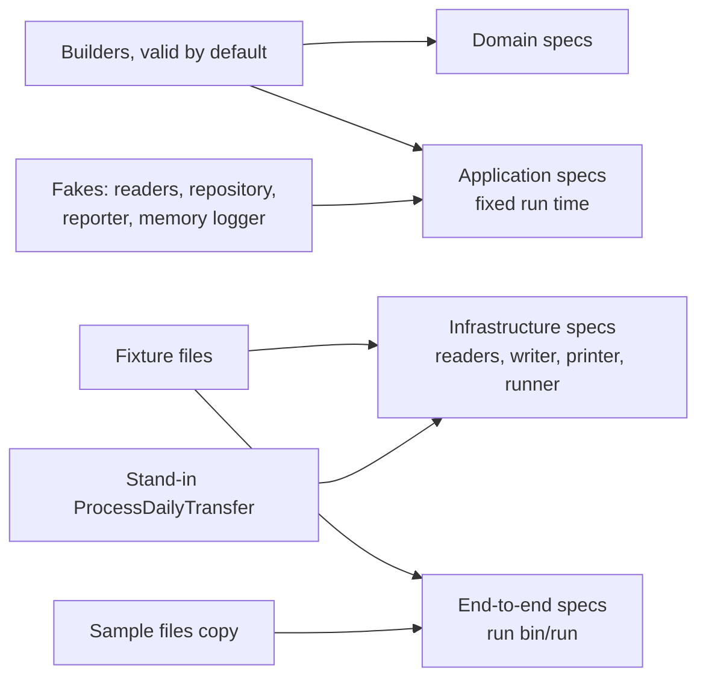

# 9. Considerations

How the design handles errors, output streams, testing, cost, money, scale, portability, change and risk.

## Error handling by layer

Each layer handles only the errors it can understand. A layer never prints an error or exits on behalf of another; only the `Runner` prints error messages and sets the exit status ([DEC-25](../design-analysis/design-decisions.md#dec-25), [DEC-28](../design-analysis/design-decisions.md#dec-28)). The [components page](06-components.md) lists which check lives where; this section names each error, who raises it and what happens to it.

| Layer | Errors it raises, and who raises them | What happens next |
|---|---|---|
| Domain | `InvalidAccountNumber` (`AccountNumber`: not 16 digits); `InvalidAmount` (`Money`: bad format or more than 2 decimal places; `Transfer`: an amount of $0 or less); `SameAccount` (`Transfer`); `NegativeBalance` (`Account`: a negative opening balance); `UnknownAccount` (`AccountRepository#find`); `DuplicateAccount` (`AccountRepository#add`); `InsufficientFunds` (`Account#withdraw`) | The domain knows no line numbers, prints nothing and logs nothing. The application layer catches these errors. |
| File reading (`BalancesCsvReader`, `TransfersCsvReader`) | `UnreadableFile`: an input file that exists but cannot be opened, or a file the CSV library cannot read past some line, naming that line ([DEC-04](../design-analysis/design-decisions.md#dec-04)) | Every row before the unreadable line is given first, each with its physical line number ([DEC-07](../design-analysis/design-decisions.md#dec-07)). A row with the wrong number of fields is not an error: it is marked, and becomes `malformed_row` for transfers or a problem line for balances. |
| Application, balances (`LoadBalances`) | `InvalidBalancesFile`, carrying every problem with its line number, or the no-rows message ([DEC-11](../design-analysis/design-decisions.md#dec-11), [DEC-12](../design-analysis/design-decisions.md#dec-12)) | Turns each `InvalidAccountNumber`, `InvalidAmount`, `NegativeBalance` and wrong field count into a problem line and keeps checking. Before checking a row's balance, it asks `AccountRepository#include?` whether the account number is already held, and if so reports the duplicate naming the first line. An `UnreadableFile` naming a line becomes the last problem line, after the problems found before it ([DEC-04](../design-analysis/design-decisions.md#dec-04)). An `UnreadableFile` for a file that cannot be opened at all passes straight through to the `Runner`, because it has its own message. |
| Application, transfers (`ProcessDailyTransfer`) | `NoTransfers` for a transfers file with no rows ([DEC-20](../design-analysis/design-decisions.md#dec-20)); `TotalChanged` when the total after differs from the total before ([DEC-24](../design-analysis/design-decisions.md#dec-24)) | Turns each domain error from one transfer into a rejected `TransferResult` and carries on ([DEC-14](../design-analysis/design-decisions.md#dec-14), [DEC-19](../design-analysis/design-decisions.md#dec-19)): `InvalidAccountNumber` to `invalid_account_number`, `InvalidAmount` to `invalid_amount`, `SameAccount` to `same_account`, `UnknownAccount` to `unknown_account`, `InsufficientFunds` to `insufficient_funds`; a marked row to `malformed_row`. When every transfer is rejected, logs the warning and still completes ([DEC-21](../design-analysis/design-decisions.md#dec-21)). |
| Infrastructure output (`FinalBalancesCsvWriter`) | `OutputNotWritable`: the file cannot be created, appeared after the start checks, or failed partway | Deletes a partial file it created itself before raising. A file that appeared after the start checks belongs to someone else and is left unchanged ([DEC-27](../design-analysis/design-decisions.md#dec-27)). |
| Runner | No error class: it finds wrong arguments, missing input files and an existing output file itself | Catches every run-stopping error above, prints the plain message on standard error, logs one error line (none for the usage message, because the run never started), and returns exit status 1 ([DEC-23](../design-analysis/design-decisions.md#dec-23), [DEC-25](../design-analysis/design-decisions.md#dec-25)). No Ruby stack trace (Ruby's list of the methods running when the error happened) reaches the user for any of these. |

`InvalidBalancesFile`, `NoTransfers` and `TotalChanged` live in `application/`; `UnreadableFile` and `OutputNotWritable` live in `infrastructure/`.

Two rules hold across the layers:

- **A rejected transfer is a result, not an error.** Domain errors raised while applying a transfer never leave `ProcessDailyTransfer`; they become a `TransferResult` with one reason code. Only problems that make the whole day unsafe stop the run.
- **Nothing is written and nothing is reported when the run stops.** The writer runs only after the total check passes, and the report is printed only after the output file is written ([DEC-26](../design-analysis/design-decisions.md#dec-26)). So every stopping error happens before the output file exists, or the writer removes its own partial file ([DEC-25](../design-analysis/design-decisions.md#dec-25), [DEC-27](../design-analysis/design-decisions.md#dec-27)).

An error the design does not expect (a bug) is not caught by the runner. Ruby prints its stack trace and exits with status 1, so a stopped run still means status 1. A bug after the output file is written can leave that file in place. **(assistant's pick)** Reason: catching every error behind a friendly message would hide bugs from the developer. Rejected: a catch-all with a generic message; a separate exit status for bugs ([DEC-25](../design-analysis/design-decisions.md#dec-25) has only 0 and 1).

The order in which a run makes its checks is shown in the [logical flow](07-logical-flow/README.md).

## Standard output, standard error and exit codes

The exact report, messages and log lines are on the [functional requirements page](02-functional-requirements.md) (FR-08 and FR-09). These tables show only which stream carries what, and which situation gives which exit status.

| Stream | What it carries | When |
|---|---|---|
| Standard output | The report: transfers, summary, all-rejected warning, final balances, output path ([DEC-26](../design-analysis/design-decisions.md#dec-26)) | Once, at the end of a completed run, after the output file is written. `ProcessDailyTransfer` prints it through the reporter (`ReportPrinter`) passed in to it. |
| Standard error, plain text | The full error message, with line numbers and full account numbers ([DEC-28](../design-analysis/design-decisions.md#dec-28)), printed by the `Runner` | Only when the run stops |
| Standard error, log lines | Timestamped `Logger` lines with masked account numbers ([DEC-29](../design-analysis/design-decisions.md#dec-29)): warn by default, info when `LOG_LEVEL=info` | During the run, only for events at or above the chosen level; a sample run at the default level writes none |

| Situation | Found by | Standard error | Exit |
|---|---|---|---|
| Run completed, even if some or every transfer was rejected ([DEC-21](../design-analysis/design-decisions.md#dec-21)) | `ProcessDailyTransfer` returns a `DayResult` | Log lines only, at the chosen level | 0 |
| Wrong number of arguments ([DEC-22](../design-analysis/design-decisions.md#dec-22)) | `Runner` | Usage message, no log line | 1 |
| Start checks: an input file missing, the output file already existing, or both ([DEC-23](../design-analysis/design-decisions.md#dec-23), [DEC-25](../design-analysis/design-decisions.md#dec-25)) | `Runner` | One `Error:` line for each problem found, all reported together, then one log line listing only the reasons that occurred: `Run stopped: start checks failed (file not found, output file already exists)` | 1 |
| An input file exists but cannot be opened ([DEC-23](../design-analysis/design-decisions.md#dec-23)) | `UnreadableFile` | `Error: cannot read file <path>: <reason from the system>`, then `Run stopped: cannot read file` | 1 |
| Invalid balances file, including no rows or an unreadable line ([DEC-11](../design-analysis/design-decisions.md#dec-11), [DEC-12](../design-analysis/design-decisions.md#dec-12)) | `InvalidBalancesFile` | Every problem with its line number, then one log line | 1 |
| Transfers file with no rows ([DEC-20](../design-analysis/design-decisions.md#dec-20)) | `NoTransfers` | One message, one log line | 1 |
| Transfers file unreadable past a line ([DEC-04](../design-analysis/design-decisions.md#dec-04)) | `UnreadableFile` | The message names the line, then one log line | 1 |
| Total of all balances changed ([DEC-24](../design-analysis/design-decisions.md#dec-24)) | `TotalChanged` | One message, one log line | 1 |
| Output file cannot be written ([DEC-27](../design-analysis/design-decisions.md#dec-27)) | `OutputNotWritable` | One message with the system's reason, one log line | 1 |

Every exit status 1 in this table means no report is printed and no output file is written; an output file that already existed is left unchanged ([DEC-25](../design-analysis/design-decisions.md#dec-25)). An input file that cannot be opened is found when it is opened, after the start checks have passed (AC-09.3a on [page 2](02-functional-requirements.md#fr-09-the-runner)).

Keeping the report alone on standard output means a user can save it with `bin/run > report.txt` while warnings and errors still show on the screen.

## Testing strategy

Each rule is tested once, at the level where it lives ([DEC-34](../design-analysis/design-decisions.md#dec-34)). This keeps the tests orthogonal: when a rule breaks, one spec fails, and its name says which rule. Unit specs use builders (helpers that make a valid test object, so a test only sets the field it is about). Because the readers, writer, repository, reporter and logger are all passed in to `ProcessDailyTransfer`, application specs pass fakes (small test objects that stand in for the real ones), such as readers that give rows from memory. File-level specs use fixture files (small CSV files kept for tests). RSpec runs every spec in random order.

| Level | Folder | What it proves | Inputs |
|---|---|---|---|
| Unit, domain | `spec/domain/` | Every value rule and every bad-row case found in the design review ([DEC-34](../design-analysis/design-decisions.md#dec-34)): each domain error named above, $0 rules, exactly $0.00 left ([DEC-13](../design-analysis/design-decisions.md#dec-13)), both balances unchanged on a rejection ([DEC-18](../design-analysis/design-decisions.md#dec-18)), `include?` on the repository | Small builders, no files |
| Unit, application | `spec/application/` | Domain errors mapped to reason codes in check order, file order, every balances problem collected with its line ([DEC-12](../design-analysis/design-decisions.md#dec-12)), duplicate message naming both lines; the known gap: a duplicate whose first copy has an invalid balance reports only the first row's problem; no-rows balances file ([DEC-11](../design-analysis/design-decisions.md#dec-11)), `NoTransfers` ([DEC-20](../design-analysis/design-decisions.md#dec-20)), all-rejected warning, `TotalChanged` ([DEC-24](../design-analysis/design-decisions.md#dec-24)), the report printed once through the reporter, which events are logged at info, warn and error, and masked account numbers (`************6789`) | Builders, fakes, a fixed run time ([DEC-30](../design-analysis/design-decisions.md#dec-30)); a temporary folder for the total-check spec |
| Integration, infrastructure | `spec/infrastructure/` | Readers: blank lines, header row, byte-order mark (an invisible marker some editors put at the start of a file), unclosed quote, empty file, a file that cannot be opened, wrong field count, leading zeros kept. Writer: output name, LF line endings, no overwrite, partial file removed, `OutputNotWritable`. `ReportPrinter`: output path shown relative or in full. `Runner`: start checks reported together, `LOG_LEVEL` default warn, `info` in any letter case, an unknown value falling back to warn ([DEC-28](../design-analysis/design-decisions.md#dec-28)), an existing output file left unchanged ([DEC-25](../design-analysis/design-decisions.md#dec-25)), an account number with leading zeros matched across both files (fixture files), each run-stopping error giving its message, one log line and exit status 1 | Fixture files in `spec/fixtures/`, a temporary folder, a stand-in `ProcessDailyTransfer` that raises `TotalChanged` ([DEC-24](../design-analysis/design-decisions.md#dec-24)) |
| End to end | `spec/acceptance/` | The whole program: report, output CSV and exit status for the sample files ([DEC-35](../design-analysis/design-decisions.md#dec-35)), mixed rejections, all rejected, invalid balances; usage message with 1 argument ([DEC-22](../design-analysis/design-decisions.md#dec-22)) | `spec/fixtures/sample/` and fixture files |

Details:

- **Total check ([DEC-24](../design-analysis/design-decisions.md#dec-24)).** Correct code can never change the total, so the error path is tested with fakes. Two specs prove its four checks between them:
  - The `ProcessDailyTransfer` spec passes a fake repository whose total changes after the transfers, and a fake reporter. It checks that `TotalChanged` is raised with the message, that no output file exists, and that the fake reporter was never called, so no report is printed.
  - The `Runner` spec stubs `ProcessDailyTransfer.new` to return a stand-in whose run raises `TotalChanged`, and checks the message on standard error, the one error log line and exit status 1.

  **(assistant's pick)** Reason: each spec proves the part its class owns, and the `Runner` needs no setting that exists only for a test. Rejected: letting the `Runner` accept a fake repository to pass through (adds a test-only input to the `Runner`); one end-to-end run (correct code cannot change the total, so a real run cannot reach this path). The stub stands in for the whole application step, which the `Runner` spec does not own.
- **No output file in the total-check spec.** The spec uses the real `FinalBalancesCsvWriter` with an output path in a temporary folder, and checks that the file does not exist. **(assistant's pick)** Reason: it proves the outcome DEC-24 names, not only that a call was skipped. Rejected: a fake writer that records calls.
- **End-to-end runs.** Each end-to-end spec runs `bin/run` as a separate process and reads its standard output, standard error and exit status. Apart from the usage test, which passes 1 argument, each passes all three arguments and writes the output file into a temporary folder. **(assistant's pick)** Reason: it proves the real command works, and the output file name is known without controlling the clock. Rejected: running with no arguments (writes into the project's `output/` under a time-based name); calling `Runner` in the same process (does not prove `bin/run`).
- **Readable results.** `.rspec` sets `--format documentation`, so the test run reads as a list of rules. `spec_helper.rb` sets random order, so no test depends on another.
- **Coverage.** SimpleCov (a tool that measures how much of the code the tests run) reports coverage; the README shows the figure. There is no minimum that fails the build ([DEC-36](../design-analysis/design-decisions.md#dec-36)).

## Time and space

`n` is the number of rows in the transfers file and `m` the number of accounts in the balances file. These are growth rates, checked by design review, not by a timing test (NFR-02 and NFR-03 on the [non-functional requirements page](03-non-functional-requirements.md)). O(m) means the time grows in step with m; O(1) means it stays the same.

| Operation | Time | Extra space | Why |
|---|---|---|---|
| Load the balances | O(m) | O(m) | Every row is read in full and checked before any transfer runs ([DEC-32](../design-analysis/design-decisions.md#dec-32)). Each row costs one `include?` lookup and one `add`. |
| Apply one transfer | O(1) | O(1) | Two `find` lookups by account number, then `withdraw` and `deposit` ([DEC-18](../design-analysis/design-decisions.md#dec-18)). The cost does not grow with the number of accounts. |
| Whole run | O(m + n) | O(m + n) | Transfers are read one row at a time ([DEC-32](../design-analysis/design-decisions.md#dec-32)), but each `TransferResult` is kept until the end, because the report is printed once after the output file is written ([DEC-26](../design-analysis/design-decisions.md#dec-26)). |
| Total check | O(m) | O(1) | One sum before the transfers and one after ([DEC-24](../design-analysis/design-decisions.md#dec-24)). |
| Write the output file | O(m) | O(1) | One line per account, in load order. |

Reasoning:

- `AccountRepository` holds the accounts in a Ruby `Hash` keyed by account number text. A `Hash` finds a key in constant time on average and keeps insertion order, so `all` returns load order with no extra list. **(assistant's pick)** Reason: it gives O(1) `find` and `include?`, and load order, in one native structure. Rejected: an `Array` (O(m) `find`, so the whole run becomes O(m × n)); a `Hash` plus a separate order list (two structures to keep in step).
- `BigDecimal` addition and subtraction take time in proportion to the number of digits. Amounts have no upper limit ([DEC-09](../design-analysis/design-decisions.md#dec-09)), so a huge amount costs a little more, but realistic amounts have a handful of digits, so this is treated as constant.

## Money and rounding

- Every amount and balance is a `Money` value on `BigDecimal`, never a floating-point number ([DEC-09](../design-analysis/design-decisions.md#dec-09)). Floating point stores 25.60 as a value very close to, but not exactly, 25.60, so a balance could end a cent off.
- `Money` checks the text against the strict format first, then builds the `BigDecimal` from that text. A value never passes through a `Float` on the way in.
- The program only adds and subtracts. The sum or difference of two values with at most 2 decimal places has at most 2 decimal places, so **no rounding is ever needed**. A value with more than 2 decimal places is rejected with `InvalidAmount`, not rounded ([DEC-09](../design-analysis/design-decisions.md#dec-09)).
- Money is written with exactly 2 decimal places on screen and in the output CSV, so `550` in a file becomes `550.00`.
- The total check compares exact `BigDecimal` totals, so a difference of one cent is caught ([DEC-24](../design-analysis/design-decisions.md#dec-24)).

## Scalability

The design targets one company's day, which is small ([DEC-32](../design-analysis/design-decisions.md#dec-32)). This is how it behaves as things grow.

- **Very large transfers file.** Rows are read one at a time, so the raw file is never held in memory. The `TransferResult`s are held until the end for the report, so memory still grows with `n`. A file with millions of rows would need the report lines streamed as each transfer is applied.
- **Very large balances file.** All accounts are held in memory, because all state is held in memory for one run ([DEC-03](../design-analysis/design-decisions.md#dec-03), [DEC-31](../design-analysis/design-decisions.md#dec-31)). Beyond memory size, accounts would move to a database.
- **Many companies.** One run handles one company ([DEC-02](../design-analysis/design-decisions.md#dec-02)). Several companies run as separate runs with their own files. Runs share nothing but the output folder, and the output file is created only if it does not exist, so two runs never overwrite each other ([DEC-27](../design-analysis/design-decisions.md#dec-27)).
- **What changes in production.** The README lists the first three ([DEC-37](../design-analysis/design-decisions.md#dec-37)):
  - a database repository with database transactions, or sagas (a series of steps across services, each with an undo step), in place of the in-memory check-then-change ([DEC-18](../design-analysis/design-decisions.md#dec-18));
  - storage that remembers which files and transfers were applied, so a rerun cannot apply a day twice ([DEC-03](../design-analysis/design-decisions.md#dec-03));
  - streaming or chunking very large files ([DEC-32](../design-analysis/design-decisions.md#dec-32)).

  Logs could also go to a file or a logging service through the logger passed in ([DEC-28](../design-analysis/design-decisions.md#dec-28)); this is out of scope.

## Portability and CI

- **Ruby.** Pinned to the latest 3.4.x in `.ruby-version` and the Dockerfile. Runtime code uses the standard library only; `csv`, `bigdecimal` and `logger` are in the Gemfile, and `Gemfile.lock` is committed ([DEC-01](../design-analysis/design-decisions.md#dec-01)).
- **Windows, macOS and Linux.** The CSV library handles Windows line endings and a missing final newline, and a byte-order mark is ignored ([DEC-04](../design-analysis/design-decisions.md#dec-04)). Default paths are found from the project root, so `bin/run` works from any folder ([DEC-22](../design-analysis/design-decisions.md#dec-22)). On Windows the command is `ruby bin/run` ([DEC-37](../design-analysis/design-decisions.md#dec-37)).
- **Output line endings.** The output CSV always uses LF (line feed only) line endings, on every operating system, and every line ends with one, the last included. **(assistant's pick)** Reason: the same run gives the same bytes everywhere, so a test can compare the file exactly, and the file reads back as the next day's balances file on any system. Rejected: the operating system's own line ending (CRLF on Windows, so the output would differ by system).
- **Docker.** A fallback for a reviewer without Ruby 3.4 ([DEC-36](../design-analysis/design-decisions.md#dec-36)). The README shows how to mount `output/` so the CSV stays on the user's machine, and how to set `TZ` (the environment variable that sets the time zone), because the container uses UTC for the file name ([DEC-37](../design-analysis/design-decisions.md#dec-37)).
- **CI** (continuous integration: the tests run automatically on every push). A GitHub Actions workflow runs RSpec and RuboCop (a style checker) on every push ([DEC-36](../design-analysis/design-decisions.md#dec-36)). It runs one job on the latest Ubuntu runner, with Ruby taken from `.ruby-version`. **(assistant's pick)** Reason: one source for the Ruby version, and the fastest feedback. Rejected: a matrix over Windows, macOS and Linux (slower, and the code uses no system-specific features); a Ruby version written in the workflow (two places to update).

## Extensibility

How the design takes the changes most likely to come. The [high-level design](05-high-level-design.md) shows where each one fits. Because the `Runner` builds the real readers, writer, repository, reporter and logger and passes them in to `ProcessDailyTransfer`, most changes swap one of these parts and leave `ProcessDailyTransfer` unchanged.

| Change | Where it goes | What stays the same |
|---|---|---|
| Another input format, such as JSON | A new reader in `infrastructure/` that gives the same rows with line numbers and the same row-shape checks, built by the `Runner` and passed in ([page 5](05-high-level-design.md#adding-another-input-format)) | Domain, `LoadBalances`, `ProcessDailyTransfer`, report and writer |
| Another transfer rule, such as a daily limit | The domain model that owns the data, for example `Account` or `Transfer`, plus a new error and reason code. A new rule and code need a new decision first ([DEC-19](../design-analysis/design-decisions.md#dec-19)). | File reading, runner, writer |
| Stored accounts | A database repository with the same `add`, `find`, `include?` and `all` ([DEC-31](../design-analysis/design-decisions.md#dec-31)), passed in by the `Runner` | Domain rules, `TransferService`, `ProcessDailyTransfer` |
| Logs to a file or service | A different logger passed in ([DEC-28](../design-analysis/design-decisions.md#dec-28)) | `ProcessDailyTransfer` |
| Another report layout or destination | A different reporter passed in, reading the same `DayResult` | Everything else |
| Another output format | A different writer passed in, with the same no-overwrite rule ([DEC-27](../design-analysis/design-decisions.md#dec-27)) | Domain, `ProcessDailyTransfer` |

## Risks and known limitations

| Risk or limitation | Effect | Mitigation |
|---|---|---|
| No memory of earlier runs ([DEC-03](../design-analysis/design-decisions.md#dec-03)) | Running the same transfers file twice on a day's output applies it twice | The README explains what storage would be needed |
| Results held in memory | Memory grows with the number of transfer rows | Fine for one company's day; streaming is a production item |
| An unreadable line in the transfers file ([DEC-04](../design-analysis/design-decisions.md#dec-04)) | The whole day is discarded, including transfers already applied in memory | The error names the line, so the file can be fixed and rerun |
| A duplicate account whose first copy has an invalid balance ([DEC-11](../design-analysis/design-decisions.md#dec-11), [DEC-12](../design-analysis/design-decisions.md#dec-12)) | The first copy was never added to the repository, so the later copy is not seen as a duplicate. The duplicate is reported only after the first row is fixed, on the next run. | The run still stops either way, so no doubtful balance is ever used. The repository stays the one place that knows about duplicates. |
| Balances file missing an account | Every transfer touching it is rejected as `unknown_account` ([DEC-17](../design-analysis/design-decisions.md#dec-17)) | The report shows each rejection with its line |
| Two default-path runs in the same second | The second stops with "output file already exists" at the start checks, or with `OutputNotWritable` if the first run writes the file after the second run's start checks; the first file is never overwritten ([DEC-27](../design-analysis/design-decisions.md#dec-27)) | Run again, or give an output path |
| Full account numbers on screen and in the output CSV ([DEC-29](../design-analysis/design-decisions.md#dec-29)) | Anyone who sees the report or file sees the numbers | Logs are masked; the output folder is not committed |
| Docker clock in UTC | The file name carries UTC time unless `TZ` is set | The README says to set `TZ` ([DEC-37](../design-analysis/design-decisions.md#dec-37)) |
| Total check failure cannot happen with correct code | Its error path could go untested | Tested with a fake repository and a fake reporter, split across the `ProcessDailyTransfer` and `Runner` specs ([DEC-24](../design-analysis/design-decisions.md#dec-24)) |

## README and submission

The repository root `README.md` is where a reviewer starts. It must give everything [DEC-37](../design-analysis/design-decisions.md#dec-37) lists:

- build, test and run instructions: `bundle install` and `bin/run` first, then Docker, with commands for the program and the tests;
- `ruby bin/run` on Windows, and mounting `output/` and setting `TZ` with Docker;
- that files must have no header ([DEC-06](../design-analysis/design-decisions.md#dec-06));
- `LOG_LEVEL` and its two values, and what exit statuses 0 and 1 mean;
- the assumptions, and the design reasoning ([DEC-30](../design-analysis/design-decisions.md#dec-30));
- the coverage figure from SimpleCov ([DEC-36](../design-analysis/design-decisions.md#dec-36));
- the production items: very large files, database transactions and sagas, and the storage a rerun-safe version would need, with remembering applied files across runs out of scope ([DEC-03](../design-analysis/design-decisions.md#dec-03), [DEC-18](../design-analysis/design-decisions.md#dec-18), [DEC-32](../design-analysis/design-decisions.md#dec-32)).

The solution is submitted as a link to the GitHub repository, made public or shared with the reviewer at submission time, so the reviewer sees the code, the commit history and the GitHub Actions results in one place ([DEC-38](../design-analysis/design-decisions.md#dec-38)). Before submission, every RuboCop offence is fixed and the Dockerfile is tested from a clean checkout ([DEC-36](../design-analysis/design-decisions.md#dec-36)).

[Back to the solution design](README.md)
