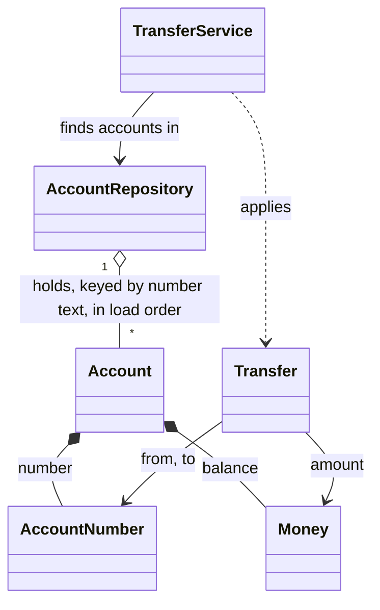

# Data model: Domain and project skeleton

Phase 1 of the [plan](plan.md). Names and meanings are those of [page 6](../../docs/solution-design/06-components.md) and the [page 10 glossary](../../docs/solution-design/10-traceability-glossary-assumptions.md#glossary); the members left open there are the plan's "Decided in the run" items (D-numbers). Exact messages are in the [spec's message table](spec.md#domain-error-messages) and in [contracts/domain-api.md](contracts/domain-api.md).

## Overview



`TransferResult` stands alone: it holds a line number, the row's fields and one reason code, not domain objects.

## One home per rule (FR-028, NFR-05)

| Rule | Lives in | Error | Decision |
|---|---|---|---|
| Exactly 16 digits, kept as text | `AccountNumber` | `InvalidAccountNumber` | DEC-08 |
| Money format, at most 2 decimals, never rounded | `Money` | `InvalidAmount` | DEC-09 |
| Transfer amount above $0 | `Transfer` | `InvalidAmount` | DEC-10 |
| From and to accounts differ | `Transfer` | `SameAccount` | DEC-13 |
| No overdraft; exactly $0.00 allowed | `Account#withdraw` | `InsufficientFunds` | DEC-13 |
| Opening balance not negative; $0.00 allowed | `Account.check_opening_balance` | `NegativeBalance` | DEC-10, DEC-11 |
| No duplicate account | `AccountRepository#add` | `DuplicateAccount` | DEC-11, DEC-31 |
| Unknown account; never created | `AccountRepository#find` | `UnknownAccount` | DEC-17, DEC-31 |

## Entities

### `AccountNumber` (value)

| Member | Type | Meaning |
|---|---|---|
| `AccountNumber.new(text)` | String | Raises `InvalidAccountNumber` unless `text` matches `\A[0-9]{16}\z` (R4) |
| `to_s` | String | The full text, leading zeros kept |
| `==`, `eql?`, `hash` | | Equal when the text is equal |

- Validation: "exactly 16 characters, each a digit 0 to 9" (FR-001). No check digit; no masking (FR-002).
- Frozen once built (D19).

### `Money` (value)

| Member | Type | Meaning |
|---|---|---|
| `Money.amount(text)` | String | A transfer amount; messages use the word `amount` (D4) |
| `Money.balance(text)` | String | An opening balance; messages use the word `balance` (D4) |
| `Money.new(value, text = nil)` | `BigDecimal`, String | Builds a value; used by the two class methods and by `+` and `-` (D5) |
| `text` | String | The text as written; for a computed value, the same as `to_s` |
| `to_s` | String | Exactly 2 decimal places, no leading zeros before the units digit (R6) |
| `+`, `-` | `Money` | Exact sum or difference, as a computed `Money` |
| `<=>` (with `Comparable`), `==`, `eql?`, `hash` | | By value only, so `-0` equals `0` (R7) |
| `negative?` | Boolean | A minus sign was written, or the value is below 0 (R7) |
| `positive?` | Boolean | The value is above 0 |

- Validation, in order (R5): empty text, "`<label> is empty`"; `-?digits.digits{3,}`, "`<label> "<text>" has more than 2 decimal places`"; anything not `-?digits(.d{1,2})?`, "`<label> "<text>" is not a valid amount`".
- `Money` does not decide whether a negative value is allowed (FR-004). No upper limit (DEC-09). Frozen (D19).

### `Account` (aggregate root)

| Member | Type | Meaning |
|---|---|---|
| `Account.check_opening_balance(balance)` | `Money` | Raises `NegativeBalance` when `balance.negative?`; otherwise returns nothing (D7) |
| `Account.new(number, balance)` | `AccountNumber`, `Money` | Runs `check_opening_balance`, then holds both (D6) |
| `number` | `AccountNumber` | |
| `balance` | `Money` | The current balance |
| `withdraw(money)` | `Money` | Raises `InsufficientFunds` when `(balance - money).negative?`, leaving the balance unchanged; otherwise sets `balance` to `balance - money` |
| `deposit(money)` | `Money` | Sets `balance` to `balance + money`; cannot fail |

- State: the balance is the only data in the domain that changes, and only through `withdraw` and `deposit` (FR-010).
- Neither `withdraw` nor `deposit` checks that the amount is above $0 (FR-012, spec clarification 3).

### `Transfer` (value)

| Member | Type | Meaning |
|---|---|---|
| `Transfer.new(from:, to:, amount:)` | `AccountNumber`, `AccountNumber`, `Money` | Raises `InvalidAmount` unless `amount.positive?`; then `SameAccount` when `from == to` (D8) |
| `from`, `to`, `amount` | | The three values |

- No lookup, no balance, no `Account` (FR-009). Frozen (D19).

### `TransferResult` (domain result)

| Member | Type | Meaning |
|---|---|---|
| `TransferResult::REASON_CODES` | frozen Array of Symbol | `[:malformed_row, :invalid_account_number, :invalid_amount, :same_account, :unknown_account, :insufficient_funds]`, in DEC-19 order (D10) |
| `TransferResult.applied(line_number:, fields:)` | Integer, Array of String | An applied result |
| `TransferResult.rejected(line_number:, fields:, reason:, header_hint: nil)` | Integer, Array of String, Symbol, String or nil | A rejected result; `ArgumentError` when `reason` is not in `REASON_CODES` (D9, D10, D11) |
| `line_number` | Integer | As given |
| `fields` | frozen Array of String | Every field of the row, in order, as given; any number of fields |
| `reason` | Symbol or nil | nil when applied |
| `header_hint` | String or nil | Only on a rejected result, and only when given |
| `applied?`, `rejected?` | Boolean | |

- It never formats itself (FR-025). Frozen (D19).

### `AccountRepository`

| Member | Type | Meaning |
|---|---|---|
| `AccountRepository.new` | | Empty |
| `add(account)` | `Account` | Raises `DuplicateAccount` when the number is held, keeping the first account; otherwise stores it |
| `include?(account_number)` | `AccountNumber` | Whether the number is held |
| `find(account_number)` | `AccountNumber` | The held `Account` (the same object), or `UnknownAccount`; never adds one |
| `all` | Array of `Account` | In the order added |

- Storage: one `Hash` keyed by `account.number.to_s` (R8). In memory for one run; no line numbers (FR-018).
- Cost: `add`, `include?`, `find` O(1); `all` O(m), each account once (FR-033, FR-035).

### `TransferService`

| Member | Type | Meaning |
|---|---|---|
| `TransferService.new(repository)` | `AccountRepository` | (D12) |
| `apply(transfer)` | `Transfer` | `find(from)`, `find(to)`, `withdraw`, `deposit`; returns nil; lets `UnknownAccount` and `InsufficientFunds` pass with both balances unchanged |

- O(1) per transfer: two lookups, the checks, two balance changes (FR-034). No rows, results, logs or undo (FR-020).

### Domain errors

All seven are direct subclasses of `StandardError` in `lib/domain/errors.rb` (D3), with no line number and no reason code (FR-026, FR-027). Who builds the message (D21):

| Error | Built with | Message |
|---|---|---|
| `InvalidAccountNumber` | `InvalidAccountNumber.new(text)` | `account number "<text>" must be exactly 16 digits` |
| `InvalidAmount` | `InvalidAmount.new(message)`, the full message from `Money` or `Transfer` | the four forms in the message table |
| `SameAccount` | `SameAccount.new(account_number)` | `account <number> cannot transfer to itself` |
| `NegativeBalance` | `NegativeBalance.new(balance)` (a `Money`; uses `balance.text`) | `balance "<text>" must not be negative` |
| `UnknownAccount` | `UnknownAccount.new(account_number)` | `account <number> is not loaded` |
| `DuplicateAccount` | `DuplicateAccount.new(account_number)` | `account <number> appears more than once` |
| `InsufficientFunds` | `InsufficientFunds.new(account_number, amount, balance)` (`Money#to_s` for both) | `account <number> cannot pay <amount> from a balance of <balance>` |

## State transitions

Only an `Account`'s balance changes:

```text
balance b --withdraw(m), b - m >= 0.00--> b - m
balance b --withdraw(m), b - m <  0.00--> b (InsufficientFunds raised)
balance b --deposit(m)-----------------> b + m
```

A `Transfer` through `TransferService` either takes both accounts through one withdraw and one deposit, or leaves both unchanged.
