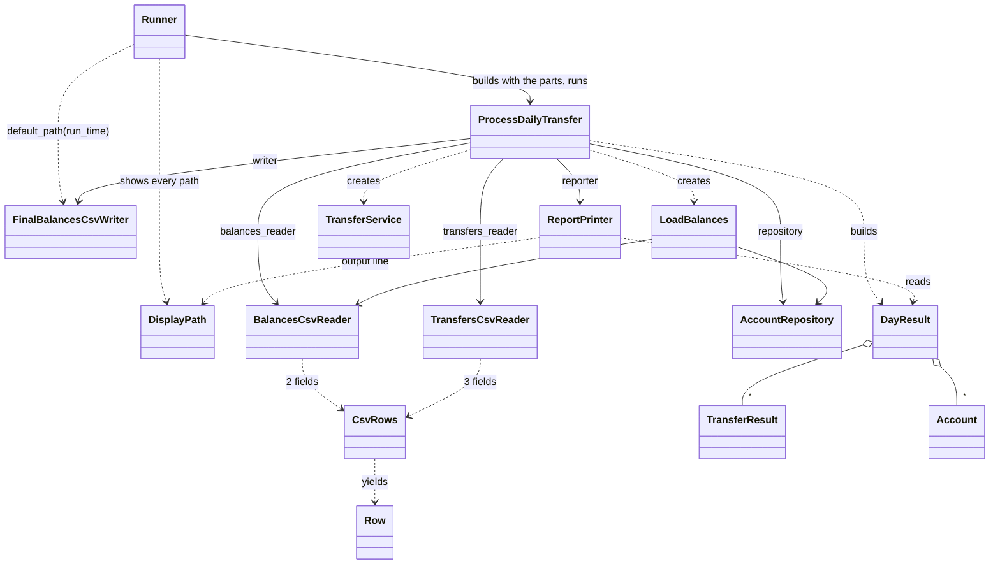

# Data model: File reading, the day's run and the runner

Phase 1 of the [plan](plan.md). Names and meanings are those of [page 6](../../docs/solution-design/06-components.md) and the [page 10 glossary](../../docs/solution-design/10-traceability-glossary-assumptions.md#glossary); the members left open there are the plan's "Decided in the run" items (P-numbers). The domain classes are `001`'s, exactly as in its [data model](../001-domain/data-model.md) and [contract](../001-domain/contracts/domain-api.md); they are used here, not changed. Exact messages are in the spec's [run-stopping messages table](spec.md#run-stopping-messages) and in [contracts/components-api.md](contracts/components-api.md).

## Overview



## One home per rule

| Rule | Lives in | Error or outcome | Decision |
|---|---|---|---|
| Read with the CSV library, `bom\|utf-8`, physical line numbers, blank lines skipped, values trimmed of spaces and tabs | `CsvRows` | `Row`s | DEC-04, DEC-05, DEC-07 |
| A file that cannot be opened; a line the library cannot read past | `CsvRows` | `UnreadableFile` | DEC-04, DEC-23 |
| The header hint on a header-looking first data row | `CsvRows` | `Row#header_hint` | DEC-06 |
| 2 fields in a balances row, 3 in a transfers row | `BalancesCsvReader::FIELD_COUNT`, `TransfersCsvReader::FIELD_COUNT`; `Row#wrong_field_count?` | a problem line, or `malformed_row` | DEC-04, DEC-19 |
| Every balances problem collected, in field order, with its line; the duplicate's first line; the no-rows file | `LoadBalances` | `InvalidBalancesFile` | DEC-11, DEC-12 |
| Domain error to reason code; one pass in file order; no retry | `ProcessDailyTransfer` | `TransferResult` | DEC-14 to DEC-16, DEC-19 |
| No transfers rows | `ProcessDailyTransfer` | `NoTransfers` | DEC-20 |
| Every row rejected | `ProcessDailyTransfer` (log), `DayResult#all_rejected?` (report) | the warning | DEC-21 |
| Total before equals total after | `ProcessDailyTransfer` | `TotalChanged` | DEC-24 |
| Masking in log lines | `ProcessDailyTransfer` (private) | log text | DEC-29 |
| Counts processed, applied, rejected, per reason | `DayResult` | numbers | DEC-19, DEC-26 |
| Default output name; never overwrite; folders created; LF; partial file removed | `FinalBalancesCsvWriter` | `OutputNotWritable` | DEC-25, DEC-27 |
| Report layout | `ReportPrinter` | standard output | DEC-26 |
| A path shown relative or in full | `DisplayPath` | text | DEC-26 |
| Arguments, start checks, `LOG_LEVEL`, the clock, `Error: ` and `Run stopped: ` lines, exit status | `Runner` | standard error, 0 or 1 | DEC-22 to DEC-25, DEC-28 |

## Entities

### `Row` (value, infrastructure; plan P2)

| Member | Type | Meaning |
|---|---|---|
| `Row.new(line_number:, fields:, expected_size:, header_hint: nil)` | Integer, Array of String, Integer, String or nil | One row as a reader gives it |
| `line_number` | Integer | The physical line where the row starts, from 1, blank lines counted |
| `fields` | Array of String | Every value of the row, in order, trimmed; a missing value is `""` |
| `expected_size` | Integer | 2 for balances, 3 for transfers |
| `header_hint` | String or nil | `CsvRows::HEADER_HINT` on a header-looking first data row, otherwise nil |
| `wrong_field_count?` | Boolean | `fields.size != expected_size` |

- A `Data` value: frozen, equal by content.

### `CsvRows` (infrastructure; plan P3)

| Member | Type | Meaning |
|---|---|---|
| `CsvRows::HEADER_HINT` | String | `This looks like a header row; files must not have a header.` |
| `CsvRows.new(path, expected_size)` | String, Integer | |
| `each { \|row\| ... }` | `Row` | Yields each non-blank row in file order; `Enumerable` |

- Raises `UnreadableFile.cannot_open(path, error)` for a `SystemCallError`, and `UnreadableFile.at_line(path, line)` for a `CSV::MalformedCSVError`, after yielding every earlier row ([research R1, R2](research.md#r1-reading-a-csv-file-row-by-row-with-its-line-number)).
- Holds one row at a time; never the file's text (NFR-03).

### `BalancesCsvReader` and `TransfersCsvReader` (infrastructure)

| Member | Type | Meaning |
|---|---|---|
| `BalancesCsvReader::FIELD_COUNT`, `TransfersCsvReader::FIELD_COUNT` | Integer | 2 and 3 |
| `.new` | | No arguments (page 6 pick 36) |
| `each_row(path) { \|row\| ... }` | `Row` | `CsvRows.new(path, FIELD_COUNT).each` |

- Do not check values, build domain models, skip a header or check existence (FR-006).

### `LoadBalances` (application; plan P5)

| Member | Type | Meaning |
|---|---|---|
| `LoadBalances.new(reader, repository)` | a reader with `each_row`, `AccountRepository` | |
| `call(path)` | String | Fills the repository and returns nil, or raises `InvalidBalancesFile` |

- State for one call: the problem lines, in file order, and a `Hash` from account number text to the line it was added from (page 6 pick 30).
- Order of checks per row: [research R4](research.md#r4-loadbalances-problem-by-problem).
- Lets an `UnreadableFile` with no line number pass unchanged (page 6 pick 33).

### `ProcessDailyTransfer` (application; plan P6)

| Member | Type | Meaning |
|---|---|---|
| `ProcessDailyTransfer.new(run_time: Time.now, **parts)` | `Time`; the six parts | `parts` holds exactly `balances_reader`, `transfers_reader`, `writer`, `repository`, `reporter`, `logger` |
| `call(balances_path, transfers_path, output_path = nil)` | String | Returns the `DayResult`, or raises a run-stopping error |

- Steps and log texts: [research R5](research.md#r5-processdailytransfer-step-by-step).
- Reason codes: `InvalidAccountNumber` `invalid_account_number`; `InvalidAmount` `invalid_amount`; `SameAccount` `same_account`; `UnknownAccount` `unknown_account`; `InsufficientFunds` `insufficient_funds`; a `Row` with `wrong_field_count?` `malformed_row` (DEC-19).
- Keeps one `TransferResult` per row until the report (NFR-03).

### `DayResult` (application; plan P7)

| Member | Type | Meaning |
|---|---|---|
| `DayResult::ALL_REJECTED_WARNING` | String | `All transfers were rejected; check this is the right file.` |
| `DayResult.new(results:, total_before:, total_after:, accounts:, output_path:)` | Array of `TransferResult`, `Money`, `Money`, Array of `Account`, String | |
| `results`, `total_before`, `total_after`, `accounts`, `output_path` | | As given; results in file order, accounts in load order |
| `processed_count`, `applied_count`, `rejected_count` | Integer | Rows, applied rows, rejected rows |
| `rejected_counts` | `Hash` of Symbol to Integer | Only the codes that occurred, in `TransferResult::REASON_CODES` order |
| `all_rejected?` | Boolean | At least one row, and every row rejected |

- A `Data` value; it formats, prints and changes nothing (FR-022).

### Run-stopping errors (plan P8)

All are direct subclasses of `StandardError`.

| Error | File | Built with | Message | `stop_reason` |
|---|---|---|---|---|
| `InvalidBalancesFile` | `application/errors.rb` | `new(problems)` | `the balances file is invalid (<count>):` then `\n  <problem>` for each | `balances file invalid: <count>` |
| `InvalidBalancesFile` | `application/errors.rb` | `no_rows(path)` | `the balances file has no rows: <path>` | `balances file invalid: 1 problem` |
| `NoTransfers` | `application/errors.rb` | `new(path)` | `the transfers file has no transfers: <path>` | `transfers file has no transfers` |
| `TotalChanged` | `application/errors.rb` | `new(before, after)` (`Money`) | `the total of all balances changed from <before> to <after>. No output file was written.` | `total of all balances changed` |
| `UnreadableFile` | `infrastructure/errors.rb` | `cannot_open(path, error)` | `cannot read file <path>: <reason>` | `cannot read file` |
| `UnreadableFile` | `infrastructure/errors.rb` | `at_line(path, line_number)` | `cannot read <path> from line <N>. Check for an unclosed quote or characters that are not text.` | `cannot read file` |
| `OutputNotWritable` | `infrastructure/errors.rb` | `new(path, error)` | `cannot write output file <path>: <reason>` | `cannot write output file` |

- `<count>` is `1 problem` or `<n> problems`. `<reason>` is the system's text (plan P9). `InvalidBalancesFile#problems` returns the problem lines; `TotalChanged#before` and `#after` the totals; `UnreadableFile#path` and `#line_number` (nil for `cannot_open`) and `#line_problem` (`cannot read <path> from this line. Check for an unclosed quote or characters that are not text.`).

### `FinalBalancesCsvWriter` (infrastructure; plan P13)

| Member | Type | Meaning |
|---|---|---|
| `FinalBalancesCsvWriter.default_path(run_time)` | `Time` | `output/final_balances_YYYY-MM-DD_HHMMSS.csv` |
| `.new` | | No arguments |
| `write(accounts, path)` | Array of `Account`, String | One `<number>,<balance>\n` line per account, in the order given; creates missing folders; never overwrites; deletes its own partial file; raises `OutputNotWritable` |

### `ReportPrinter` (infrastructure; plan P14)

| Member | Type | Meaning |
|---|---|---|
| `ReportPrinter.new(output: $stdout, current_folder: Dir.pwd)` | IO, String | |
| `print(day_result)` | `DayResult` | Prints the report (FR-027, FR-028) to `output` |

### `DisplayPath` (infrastructure; plan P10)

| Member | Type | Meaning |
|---|---|---|
| `DisplayPath.of(path, folder = Dir.pwd)` | String, String | The path relative to `folder` with at most one leading `../`, or in full |

### `Runner` (infrastructure; plan P12)

| Member | Type | Meaning |
|---|---|---|
| `Runner::STOPPING_ERRORS` | Array of classes | `InvalidBalancesFile`, `NoTransfers`, `TotalChanged`, `UnreadableFile`, `OutputNotWritable` |
| `Runner.new(stdout: $stdout, stderr: $stderr, env: ENV)` | IO, IO, `Hash`-like | |
| `run(arguments)` | Array of String | Returns 0 or 1 ([research R7](research.md#r7-the-runner)) |

### `bin/run` (command; plan P26)

`exit(Runner.new.run(ARGV))`, nothing else.

## Run states

```text
arguments wrong ------------------------------> usage on stderr, exit 1
start checks fail ----------------------------> Error: lines + 1 log line, exit 1
LoadBalances raises InvalidBalancesFile -------> Error: message + 1 log line, exit 1
a reader raises UnreadableFile ----------------> Error: message + 1 log line, exit 1
no transfers rows ----------------------------> NoTransfers, exit 1
total changed --------------------------------> TotalChanged, exit 1 (no file, no report)
writer raises OutputNotWritable --------------> exit 1 (no file left, no report)
otherwise -> file written -> report printed --> exit 0
```

Only an `Account`'s balance changes during a run, through `TransferService` (`001`). Nothing is kept after the run (DEC-03).
